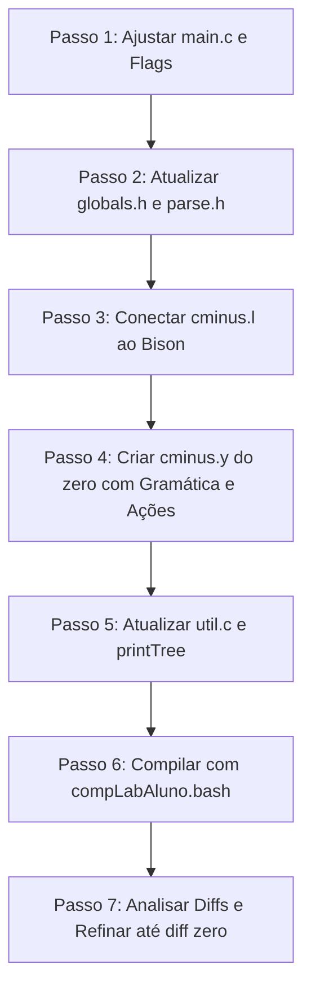

# Guia de Laboratório 2: Analisador Sintático (Parser) para C-

Este documento apresenta um guia didático, passo a passo e aprofundado para o desenvolvimento do **Analisador Sintático (Parser)** da linguagem **C-** no âmbito da disciplina CTC-41 / CES-41 (Compiladores).

> ℹ️ **NOTA:**
> **Foco Exclusivo deste Laboratório:**
> Neste momento, você deve se preocupar **apenas** com a **Análise Sintática**, a **Construção da Árvore Sintática Abstrata (AST)**, a **Impressão formatada da AST** e o **Tratamento de Erros Sintáticos**.
> A **Tabela de Símbolos** (Análise Semântica) e a **Geração de Código** devem permanecer desativadas nesta etapa (`NO_ANALYZE TRUE` e `NO_CODE TRUE`).

---

## 📑 Sumário

* [1. Visão Geral: O que é o Laboratório 2?](#1-visão-geral-o-que-é-o-laboratório-2)
* [2. O que o Professor Já Forneceu vs. O que Você Tem que Fazer de Novo](#2-o-que-o-professor-já-forneceu-vs-o-que-você-tem-que-fazer-de-novo)
* [3. O que é o Bison e Qual a sua Função no Compilador](#3-o-que-é-o-bison-e-qual-a-sua-função-no-compilador)
* [4. O que o `cminus.y` é Responsável por Fazer](#4-o-que-o-cminusy-é-responsável-por-fazer)
* [5. A Gramática de C-: Da Versão Incompleta Fornecida às 3 Extensões](#5-a-gramática-de-c--da-versão-incompleta-fornecida-às-3-extensões)
* [6. Estrutura da Árvore Sintática Abstrata (AST)](#6-estrutura-da-árvore-sintática-abstrata-ast)
  * [6.1 Anatomia da Estrutura `TreeNode`](#61-anatomia-da-estrutura-treenode)
  * [6.2 O Mecanismo Fundamental: `child` (Hierarquia) vs. `sibling` (Sequência)](#62-o-mecanismo-fundamental-child-hierarquia-vs-sibling-sequência)
  * [6.3 Exemplos Práticos: Mapeando Código Real na Árvore](#63-exemplos-práticos-mapeando-código-real-na-árvore)
  * [6.4 A Grande Divisão: StmtK (Comandos e Declarações) vs. ExpK (Expressões)](#64-a-grande-divisão-stmtk-comandos-e-declarações-vs-expk-expressões)
  * [6.5 Detalhamento de Cada Categoria de Nós](#65-detalhamento-de-cada-categoria-de-nós)
  * [6.6 Tabela de Correspondência Exata com o Gabarito](#66-tabela-de-correspondência-exata-com-o-gabarito)
* [7. Tratamento de Erros Sintáticos e o Formato Exato de `yyerror()`](#7-tratamento-de-erros-sintáticos-e-o-formato-exato-de-yyerror)
* [8. Roteiro Passo a Passo para Implementar o Lab 2](#8-roteiro-passo-a-passo-para-implementar-o-lab-2)
* [9. Como Compilar, Executar os Testes e Analisar os Diffs](#9-como-compilar-executar-os-testes-e-analisar-os-diffs)
* [10. Dicas Importantes e Pegadinhas Comuns](#10-dicas-importantes-e-pegadinhas-comuns)
* [11. Checklist Final do Lab 2](#11-checklist-final-do-lab-2)

---

## 1. Visão Geral: O que é o Laboratório 2?

No **Laboratório 1**, você construiu o **Analisador Léxico (Scanner)** usando Flex (`cminus.l`), cuja função era transformar o código fonte `.cm` em um fluxo de tokens lineares (`NUM`, `ID`, `IF`, `PLUS`, etc.).

No **Laboratório 2**, o objetivo é construir o **Analisador Sintático (Parser)** usando **Bison** (`cminus.y`):
1. **Verificar a gramática**: Determinar se a sequência de tokens obedece às regras estruturais da linguagem C-.
2. **Construir a Árvore Sintática Abstrata (AST)**: Montar uma estrutura de dados em árvore (`TreeNode`) representando hierarquicamente funções, variáveis, comandos e expressões.
3. **Imprimir a AST formatada**: Reproduzir em texto a árvore sintática gerada, com indentação exata de 4 espaços, para bater com o gabarito oficial (`detail/*_syn.txt`).
4. **Capturar Erros Sintáticos**: Identificar quando o programa viola a sintaxe (ex: ponto e vírgula ausente, parênteses desalinhados) e emitir a mensagem padrão de erro sintático (`detail/*_err.txt`).

O objetivo de ouro é atingir **diff zero** nos arquivos de saída sintática (`*_syn.diff`) ao rodar os testes automatizados fornecidos pelo professor.

---

## 2. O que o Professor Já Forneceu vs. O que Você Tem que Fazer de Novo

Para que você não perca tempo tentando reinventar ferramentas ou procurando arquivos no lugar errado, veja o mapa completo da base de código:

| Item / Arquivo | Origem | Situação Atual | O que você deve fazer no Lab 2? |
| :--- | :--- | :--- | :--- |
| **Infraestrutura CMake & Scripts**<br>([`CMakeLists.txt`](CMakeLists.txt), [`compLabAluno.bash`](compLabAluno.bash), [`killbuild`](killbuild), `scripts/*`) | **Professor** | 100% pronto e funcional | **NÃO MODIFICAR.** Apenas rodar `../compLabAluno.bash` para compilar e testar. |
| **Biblioteca de Log**<br>([`lib/log.c`](lib/log.c), [`lib/log.h`](lib/log.h)) | **Professor** | 100% pronto e funcional | **NÃO MODIFICAR.** Usar apenas `pc()` e `pce()`. *(Dica: alterar `DEBUG_LOG_ALWAYS_FLUSH` para 1 apenas se precisar debugar segfault).* |
| **Casos de Teste & Gabaritos**<br>(`example/*.cm`, `detail/*`) | **Professor** | 100% pronto | **NÃO MODIFICAR.** Servem como entrada de teste e gabarito oficial para os diffs. |
| **Compilador Base TINY**<br>(`TinyGeracaoCodigo/`, `TinyFlex/`) | **Professor** | Exemplo de referência | **NÃO MODIFICAR.** É o compilador da linguagem **TINY** do livro (não é C-). Serve apenas para você consultar como o autor estruturou o código. |
| **Documentação & Especificações**<br>(`instructions/*`) | **Professor** | Disponível para leitura | Consultar as regras da linguagem C- e orientações do professor. |
| **Analisador Léxico**<br>([`src/cminus.l`](src/cminus.l)) | **Você (Lab 1)** | Pronto | **PEQUENOS AJUSTES:** Garantir inclusão de `globals.h` e retorno correto dos tokens para o Bison. |
| **Gramática & Parser Bison**<br>([`src/cminus.y`](src/cminus.y)) | **Você (Lab 2)** | **NÃO EXISTE AINDA** | **CRIAR DO ZERO!** Escrever a gramática C-, as 3 extensões, as ações que montam a AST, `yylex`, `yyerror` e `parse()`. |
| **Header do Parser**<br>([`src/parse.h`](src/parse.h)) | **Você (Lab 2)** | Não existe em `src/` | **CRIAR:** Declarar `TreeNode * parse(void);` (pode copiar de `TinyGeracaoCodigo/parse.h`). |
| **Definições Globais & AST**<br>([`src/globals.h`](src/globals.h)) | Misto | Configurado para Lab 1 | **MODIFICAR:** Apagar o `enum TokenType` manual e incluir `parser.h`; expandir `NodeKind`, `StmtKind` e `ExpKind` para C-. |
| **Construtores e Print da Árvore**<br>([`src/util.c`](src/util.c), [`src/util.h`](src/util.h)) | Misto | Versão básica do TINY | **MODIFICAR:** Atualizar `newStmtNode`/`newExpNode`; reescrever `printTree()` com 4 espaços e textos do gabarito. |
| **Ponto de Entrada**<br>([`src/main.c`](src/main.c)) | Misto | Modo scanner-only | **AJUSTAR:** Mudar `#define NO_PARSE FALSE`, ligar `TraceParse = TRUE`, e inicializar com `LOGALL`. |

---

### 2.1 Resumo da Transição em Relação ao Lab 1

| Aspecto | Lab 1 (Léxico) | Lab 2 (Sintático) |
| :--- | :--- | :--- |
| **Ferramenta Principal** | Flex apenas | Flex + **Bison** |
| **Arquivo Chave** | `src/cminus.l` | **`src/cminus.y`** + `src/cminus.l` |
| **Definição de Tokens** | `enum TokenType` manual em `globals.h` | Gerada automaticamente pelo Bison em `parser.h` |
| **Ponto de Partida (`main.c`)** | `#define NO_PARSE TRUE` | **`#define NO_PARSE FALSE`** |
| **Análise Semântica e Código** | Desativadas | **Continuam desativadas** (`NO_ANALYZE TRUE`, `NO_CODE TRUE`) |
| **Log Mask em `main.c`** | `LER` (Lex + Err) | **`LOGALL`** (ou `UP2SYN`) para gravar logs `_syn.txt` |
| **Script de Execução** | `compLabAlunoLEX.bash` | **`compLabAluno.bash`** |
| **Flag do CMake** | `-DDOPARSE=FALSE` | **`-DDOPARSE=TRUE`** |
| **Target do Make** | `make lexdiff` | **`make ddiff`** |
| **Diretório de Gabarito** | `detailonlylex/` | **`detail/`** |
| **Arquivos Alvo do Diff** | `alunodetail/*_lex.diff` | **`alunodetail/*_syn.diff`** e `*_err.diff` |

---

## 3. O que é o Bison e Qual a sua Função no Compilador?

### 3.1 O que é o Bison?
O **Bison** é um gerador de analisadores sintáticos (LALR(1) parser generator), versão moderna e de código aberto do clássico **Yacc** (*Yet Another Compiler-Compiler*).

Em vez de você escrever manualmente um algoritmo complexo em C com pilhas, autômatos e tabelas de transição para validar a gramática do C-, você escreve as regras gramaticais em formato declarativo de alto nível dentro do arquivo **`src/cminus.y`**. O Bison então lê esse arquivo e **gera automaticamente o código C correspondente** em `build/parser.c` e `build/parser.h`.

### 3.2 Onde o Bison entra no processo de compilação (Build Pipeline)?

O Bison atua na fase de pré-compilação do seu projeto. Quando você executa `./compLabAluno.bash`, o CMake orquestra o seguinte fluxo:

```
                  ONDE O BISON ENTRA NA CONSTRUÇÃO DO PROJETO
                  
   [src/cminus.y] (Suas regras gramaticais e ações em C)
          │
          ▼  (CMake chama: bison -d src/cminus.y)
   ┌─────────────────────────────────────────────────────────────┐
   │                          BISON                              │
   │                                                             │
   │  Gera dois arquivos essenciais:                             │
   │   1. build/parser.h ──► Dicionário numérico dos tokens      │
   │   2. build/parser.c ──► Algoritmo do autômato em C (yyparse)│
   └──────────────┬───────────────────────────────┬──────────────┘
                  │                               │
        incluído por:                             │
                  ▼                               ▼
          [src/cminus.l] (Flex)             [build/parser.c]
                  │                               │
                  ▼ (compilado por gcc)           ▼ (compilado por gcc)
              [lexer.o] ──────────────┬────────► [parser.o]
                                      │
                         + [main.o], [util.o], etc.
                                      │
                                      ▼ (Linkagem)
                                [build/mycmcomp]
```

1. **`build/parser.h` (A ponte Léxico-Sintático):**
   * Em C, comparar strings de texto a cada token (ex: `"IF"`, `"RETURN"`) é muito lento. Por isso, compiladores trocam **códigos numéricos inteiros**.
   * No Lab 1, você precisou criar um `enum TokenType` na mão em `globals.h`.
   * Com o Bison, você declara `%token IF ELSE INT NUM ID` no `cminus.y`. O Bison gera automaticamente o `build/parser.h` com `#define IF 258`, `#define NUM 259`, etc.
   * O Flex ([`src/cminus.l`](src/cminus.l)) inclui esse header. Quando lê a palavra `"if"`, o Flex faz `return IF;`, devolvendo o número `258`.
2. **`build/parser.c` (O motor sintático executável):**
   * Contém as tabelas de estado LALR(1) e o loop principal [`yyparse()`](src/parse.h).
   * Ele é compilado pelo GCC junto com os demais arquivos C para produzir o executável final `mycmcomp`.

### 3.3 Como o Bison funciona em tempo de execução (O Maestro da Compilação)

Durante a execução do seu compilador (`./mycmcomp programa.cm`), o Bison funciona como o **maestro** da orquestra:

```
                            EM TEMPO DE EXECUÇÃO
                            
      Bison (yyparse) ──────── chama yylex() ──────► Flex (cminus.l)
             ▲                                             │
             │                                             ▼
             │◄─────── devolve token numérico ─────────────┘
             │
     Consulta a tabela LALR:
     - Shift: empilha o token
     - Reduce: reconheceu uma regra da gramática!
             │
             ├──► Executa a sua ação em C: { $$ = newStmtNode(...); }
             └──► Conecta os nós da Árvore Sintática (AST)
```

1. O `main()` chama a função [`parse()`](src/parse.h), que inicia o [`yyparse()`](src/parse.h) do Bison.
2. O Bison não lê o arquivo de texto diretamente. Ele chama `yylex()` (que chama [`getToken()`](src/cminus.l)) do Flex e pede: *"Me dê o próximo token"*.
3. O Flex lê caracteres do arquivo, identifica o lexema e devolve o código do token (ex: `NUM`).
4. O Bison consulta sua tabela de transição de estados:
   * **Shift (Empilhamento):** guarda o token na pilha sintática e pede o próximo.
   * **Reduce (Redução):** percebe que os itens no topo da pilha formam uma regra completa da gramática (ex: `termo soma fator`). Nesse instante, ele dispara o código em C que você escreveu entre chaves `{ ... }`, instanciando nós como `newExpNode(OpK)` e ligando na árvore.
5. Se o Flex devolver um token que viola as regras gramaticais (ex: dois números em sequência sem operador), o Bison chama imediatamente a sua função [`yyerror()`](src/cminus.y), grava a mensagem no log e interrompe a análise.

---

## 4. O que o `cminus.y` é Responsável por Fazer?

O arquivo **`src/cminus.y`** é o arquivo de especificação onde você define tudo o que o Bison precisa saber sobre a linguagem C-.

### 4.1 As 6 Responsabilidades Centrais do `cminus.y`

1. **Definição Oficial dos Tokens da Linguagem (`%token`):**
   * É a "fonte da verdade" sobre quais tokens existem no compilador (`IF`, `ELSE`, `INT`, `NUM`, `ID`, etc.).
   * Dá origem automática ao arquivo `build/parser.h`.
2. **Definição da Gramática Livre de Contexto (CFG):**
   * Contém as regras de produção gramatical que especificam como os tokens se combinam para formar programas válidos em C- (funções, declarações, laços, expressões, etc.).
   * É nele que você implementa as **3 extensões obrigatórias** pedidas pelo professor (Seção 5).
3. **Resolução de Ambiguidades e Precedência de Operadores:**
   * Garante que a gramática não tenha ambiguidades.
   * O caso clássico é o *dangling else* (conflito de saber a qual `if` um `else` pertence), que deve ser resolvido usando diretivas de precedência (`%nonassoc LOWER_THAN_ELSE` e `%nonassoc ELSE`).
4. **Construção da Árvore Sintática Abstrata (AST) via Ações Semânticas:**
   * A cada vez que uma regra gramatical é reconhecida (operação de *reduce*), o Bison executa um bloco de código C delimitado por chaves `{ ... }`.
   * Nessas ações semânticas, o `cminus.y`:
     * Chama as funções construtoras de nós ([`newStmtNode`](src/util.c) e [`newExpNode`](src/util.c)).
     * Conecta nós pai e filhos usando os campos `child[0]`, `child[1]`, `child[2]`.
     * Encadeia listas de comandos, declarações, parâmetros e argumentos no campo `sibling`.
     * Propaga ponteiros de nós entre as regras usando as pseudo-variáveis do Bison (`$$` para o lado esquerdo da regra, `$1`, `$2`, `$3`... para os símbolos do lado direito).
   * Na regra inicial (`program : decl_list`), o `cminus.y` armazena o nó raiz da árvore construída na variável estática `savedTree`.
5. **Implementação da Interface de Parsing (`parse()`):**
   * O `cminus.y` implementa a função de interface `TreeNode * parse(void)` (declarada em `parse.h` e chamada na `main.c`).
   * A função `parse()` simplesmente invoca o motor do Bison (`yyparse()`) e retorna o ponteiro da árvore completa (`savedTree`).
   * Ele também define a ponte `static int yylex(void) { return getToken(); }`, que faz o Bison pedir os tokens ao `cminus.l`.
6. **Detecção e Reporte de Erros Sintáticos (`yyerror()`):**
   * Se o compilador receber um token inesperado pela gramática (ex: `int x` seguido de outro comando sem ponto e vírgula), o Bison chama automaticamente a função `yyerror(char *message)`.
   * O `cminus.y` implementa o corpo de `yyerror` para gravar a mensagem padronizada no log de erro (`_err.txt`) usando [`pce()`](lib/log.h) e marcar a flag de erro global (`Error = TRUE;`).

---

### 4.2 O que o `cminus.y` NÃO Deve Fazer (Fronteiras Claras)

* ❌ **NÃO lê arquivos nem faz expressões regulares:**
  * O `cminus.y` não processa caracteres individuais nem espaços. Essa é a função exclusiva do Flex (`cminus.l`).
* ❌ **NÃO imprime a árvore sintática nos logs:**
  * O `cminus.y` apenas **constrói** a estrutura de nós na memória RAM e devolve a raiz para a `main()`.
  * Quem percorre recursivamente esses nós e gera as strings com 4 espaços nos arquivos `alunodetail/*_syn.txt` é a função [`printTree()`](src/util.c) em `src/util.c`.
* ❌ **NÃO verifica escopo nem tipos (Semântica):**
  * O `cminus.y` não checa se uma variável usada foi declarada anteriormente.
  * O `cminus.y` não checa se você está tentando somar um `void` com um `int`.
  * O `cminus.y` não checa se você chamou uma função com número errado de argumentos.
  * **Tudo isso é papel da Análise Semântica (Tabela de Símbolos e Type Checker) no Laboratório 3!**
  * Para o `cminus.y`, códigos como `void a;` ou `x = 1;` (com `x` não declarado) têm uma estrutura sintática válida e devem gerar suas árvores normalmente (como visto nos testes `ser*.cm`).
* ❌ **NÃO gera código de máquina nem pseudo-assembly:**
  * Essa é a etapa final (Laboratório 4), que percorrerá a AST gerando instruções para o simulador `tm`.

---

## 5. A Gramática de C-: Da Versão Incompleta Fornecida às 3 Extensões

Nesta seção, comparamos a gramática original do livro/professor com a gramática final aumentada necessária para passar nos testes.

### 5.1 A Gramática Incompleta Fornecida pelo Professor

O arquivo `instructions/BNFC_AnaliseSintática.txt` e o Apêndice A do livro de Louden fornecem a seguinte especificação BNF básica:

```bnf
programa → declaração-lista
declaração-lista → declaração-lista declaração | declaração
declaração → var-declaração | fun-declaração
var-declaração → tipo-especificador ID ; | tipo-especificador ID [ NUM ] ;
tipo-especificador → int | void
fun-declaração → tipo-especificador ID ( params ) composto-decl
params → param-lista | void
param-lista → param-lista, param | param
param → tipo-especificador ID | tipo-especificador ID [ ]
composto-decl → { local-declarações statement-lista }
local-declarações → local-declarações var-declaração | vazio
statement-lista → statement-lista statement | vazio
statement → expressão-decl | composto-decl | seleção-decl | iteração-decl | retorno-decl
expressão-decl → expressão ; | ;
seleção-decl → if ( expressão ) statement | if ( expressão ) statement else statement
iteração-decl → while ( expressão ) statement
retorno-decl → return ; | return expressão;
expressão → var = expressão | simples-expressão
var → ID | ID [ expressão ]
simples-expressão → soma-expressão relacional soma-expressão | soma-expressão
relacional → <= | < | > | >= | == | !=
soma-expressão → soma-expressão soma termo | termo
soma → + | -
termo → termo mult fator | fator
mult → * | /
fator → ( expressão ) | var | ativação | NUM
ativação → ID ( args )
args → arg-lista | vazio
arg-lista → arg-lista , expressão | expressão
```

---

### 5.2 Por que a Gramática Fornecida é Incompleta? (Onde ela falha nos testes)

Se você implementar a gramática acima sem modificações, o seu compilador **falhará em vários casos de teste fornecidos**:

1. **Falha 1: Declarações e Comandos Intercalados (`block2.cm`, `sort.cm`):**
   * *O problema na gramática original:* A regra `composto-decl → { local-declarações statement-lista }` força **todas** as declarações de variáveis locais a virem rigidamente **antes** de qualquer comando executável.
   * *Onde quebra:* Em códigos como `block2.cm` ou `sort.cm`:
     ```c
     int a;
     a = 1;   /* comando */
     int b;   /* declaração DEPOIS de comando -> ERRO NA GRAMÁTICA DO LIVRO! */
     b = 2;
     ```
   * *Consequência:* O parser original acusa `Syntax error` na linha do `int b;`.

2. **Falha 2: Blocos Aninhados Independentes `{ ... }` (`block2.cm`, `mdc2.cm`):**
   * *O problema na gramática original:* Na árvore sintática exigida pelo gabarito (`detail/block2_syn.txt`), um bloco de código `{ ... }` aninhado dentro de uma função precisa gerar um nó explícito chamado **`Block:`**. Já o bloco `{ ... }` que delimita o corpo da função **não** gera o nó `Block:`.
   * *Consequência:* A gramática original não distingue entre o corpo da função e um bloco interno aninhado na árvore sintática.

3. **Falha 3: Operador de Menos Unário (`block3.cm`, `mdc2.cm`, `sort.cm`):**
   * *O problema na gramática original:* A regra `fator` do livro é apenas:
     ```bnf
     fator → ( expressão ) | var | ativação | NUM
     ```
     O símbolo `-` só existe na regra `soma → + | -` (subtração binária entre dois operandos, como `a - b`).
   * *Onde quebra:* Expressões com menos unário como `-x`, `-2`, `-gdc(...)`, `-(a - b)` ou `-(-x)` não casam com nenhuma regra!
   * *Consequência:* O parser original acusa `Syntax error` assim que encontra um `-` no início de uma expressão ou argumento.

---

### 5.3 As 3 Extensões Obrigatórias Feitas em Nível de Gramática

Para corrigir as três falhas acima, você deve fazer modificações diretas nas regras de produção do Bison:

```
┌────────────────────────────────────────────────────────────────────────────────────────┐
│             COMO AS 3 EXTENSÕES MUDAM AS REGRAS GRAMATICAIS NO BISON                   │
├────────────────────────────────────────────────────────────────────────────────────────┤
│ 1. INTERCALAÇÃO DE DECLARAÇÕES E COMANDOS:                                             │
│    • Livro Original: local-declarations VINHA OBRIGATORIAMENTE ANTES de statement-list.│
│      composto-decl → { local-declarações statement-lista }                             │
│    • Como fica agora: Uma única lista mista que aceita declaração OU statement:        │
│      composto-decl → { local-decl-ou-stmt-lista }                                      │
│      local-decl-ou-stmt-lista → local-decl-ou-stmt-lista item | vazio                  │
│      item → var-declaração | statement                                                 │
│                                                                                        │
│ 2. BLOCOS ANINHADOS COM ESCOPO { ... }:                                                │
│    • Livro Original: { ... } só existia como corpo principal de uma função.            │
│    • Como fica agora: Um bloco { ... } passa a ser um statement válido em qualquer     │
│      lugar! Na ação do Bison, ele cria um nó explícito "Block:":                       │
│      statement → ... | bloco-aninhado                                                  │
│      bloco-aninhado → { local-decl-ou-stmt-lista }                                     │
│      Ação em C: { $$ = newStmtNode(BlockK); $$->child[0] = $2; }                       │
│                                                                                        │
│ 3. OPERADOR DE SUBTRAÇÃO UNÁRIO (-):                                                   │
│    • Livro Original: Louden só aceitava menos binário (a - b).                         │
│    • Como fica agora: Adiciona-se a regra de menos unário na produção de fator:        │
│      fator → MINUS fator | ( expressão ) | var | ativação | NUM                        │
│      Ação em C: cria nó OpK com operador unário ("Op: - (unario)").                    │
└────────────────────────────────────────────────────────────────────────────────────────┘
```

---

### 5.4 Gramática Aumentada e Completa Recomendada para o `cminus.y`

Abaixo está a gramática BNF completa, com todas as extensões incorporadas, pronta para ser implementada no Bison:

```bnf
programa            → declaração-lista
declaração-lista    → declaração-lista declaração | declaração
declaração          → var-declaração | fun-declaração

var-declaração      → tipo-especificador ID ; 
                    | tipo-especificador ID [ NUM ] ;
tipo-especificador  → int | void

fun-declaração      → tipo-especificador ID ( params ) composto-decl
params              → param-lista | void
param-lista         → param-lista , param | param
param               → tipo-especificador ID | tipo-especificador ID [ ]

/* Extensão 1: declarações locais e comandos podem ser intercalados */
composto-decl       → { local-decl-ou-stmt-lista }
local-decl-ou-stmt-lista → local-decl-ou-stmt-lista local-decl-ou-stmt | vazio
local-decl-ou-stmt  → var-declaração | statement

/* Extensão 2: bloco aninhado como statement independente (gera nó Block:) */
statement           → expressão-decl 
                    | bloco-aninhado 
                    | seleção-decl 
                    | iteração-decl 
                    | retorno-decl

bloco-aninhado      → { local-decl-ou-stmt-lista }

expressão-decl      → expressão ; | ;
seleção-decl        → if ( expressão ) statement 
                    | if ( expressão ) statement else statement
iteração-decl       → while ( expressão ) statement
retorno-decl        → return ; | return expressão ;

expressão           → var = expressão | simples-expressão
var                 → ID | ID [ expressão ]

simples-expressão   → soma-expressão relacional soma-expressão | soma-expressão
relacional          → <= | < | > | >= | == | !=

soma-expressão      → soma-expressão soma termo | termo
soma                → + | -
termo               → termo mult fator | fator
mult                → * | /

/* Extensão 3: operador unário (-) aplicado recursivamente a fator */
fator               → ( expressão ) | var | ativação | NUM | - fator
ativação            → ID ( args )
args                → arg-lista | vazio
arg-lista           → arg-lista , expressão | expressão
```

---

## 6. Estrutura da Árvore Sintática Abstrata (AST)

A AST (*Abstract Syntax Tree*) é a representação em memória do programa compilado. Nesta seção, desmistificamos a estrutura de dados `TreeNode`, a relação entre os ponteiros `child` e `sibling`, e como cada nó é configurado.

### 6.1 Anatomia da Estrutura `TreeNode`

No arquivo [`src/globals.h`](src/globals.h), cada nó da árvore é uma instância de `struct treeNode`:

```c
#define MAXCHILDREN 3

typedef struct treeNode {
    struct treeNode * child[MAXCHILDREN]; /* Filhos hierárquicos (descida de nível) */
    struct treeNode * sibling;            /* Irmão próximo (mesmo nível horizontal) */
    int lineno;                           /* Linha do arquivo fonte */
    NodeKind nodekind;                    /* StmtK ou ExpK */
    union { 
        StmtKind stmt; 
        ExpKind exp; 
    } kind;                               /* Subtipo específico do nó */
    union { 
        TokenType op;                     /* Operador (+, -, <=, etc.) */
        int val;                          /* Valor numérico (se ConstK) */
        char * name;                      /* Nome de ID, função ou variável */
    } attr;
    ExpType type;                         /* Tipo de dado (Integer, Void, etc.) */
} TreeNode;
```

---

### 6.2 O Mecanismo Fundamental: `child` (Hierarquia) vs. `sibling` (Sequência)

A árvore do compilador C- usa a clássica representação **Primeiro-Filho / Próximo-Irmão (First-Child / Next-Sibling)**:

```
       Nó Pai
         │
         │ child[0] (desce para o primeiro elemento)
         ▼
     Elemento 1 ──sibling──► Elemento 2 ──sibling──► Elemento 3 ──sibling──► NULL
```

* **`child[i]` (Relação Pai-Filho):** Desce **um nível de profundidade**. É usado para subcomponentes de um comando ou expressão:
  * Em um `IfK`: `child[0]` é a condição de teste, `child[1]` é o bloco *then*, `child[2]` é o bloco *else*.
  * Em uma Função: `child[0]` aponta para o primeiro parâmetro, `child[1]` aponta para o primeiro comando do corpo.
  * Em uma Atribuição em Vetor (`a[i] = x`): `child[0]` é o índice `i`, `child[1]` é a expressão `x`.
* **`sibling` (Relação entre Irmãos):** Conecta elementos que estão no **mesmo nível sintático**:
  * Uma lista de declarações de funções globais (`gcd` → `main`).
  * Uma lista de parâmetros de uma função (`int u` → `int v`).
  * Uma lista de comandos e declarações dentro de uma função (`int x;` → `int y;` → `x = input();`).
  * Uma lista de argumentos passados em uma chamada (`gcd(x, y)` → argumento `x` aponta para `y` via `sibling`).

> 📌 **IMPORTANTE:**
> **Como a função `printTree()` usa essa estrutura:**
> Quando a função `printTree()` visita `tree->child[i]`, ela **aumenta a indentação em +4 espaços**.
> Quando ela avança por `tree->sibling`, ela **mantém a mesma indentação**, porque irmãos pertencem ao mesmo nível hierárquico!

---

### 6.3 Exemplos Práticos: Mapeando Código Real na Árvore

#### Exemplo 1: Função `gcd` (Parâmetros, Condicional e Retorno)
Considere este trecho de código C-:
```c
int gcd(int u, int v) {
    if (v == 0) return u;
}
```

Na memória RAM, os nós são conectados da seguinte forma:
```
[FunctionK: "gcd", return type "int"]
  │
  ├── child[0] (Parâmetros)
  │     ▼
  │   [ParamK: "u"] ──sibling──► [ParamK: "v"]
  │
  └── child[1] (Corpo de Comandos)
        ▼
      [IfK: "Conditional selection"]
        │
        ├── child[0] (Condição)
        │     ▼
        │   [OpK: "=="]
        │     ├── child[0] ──► [IdK: "v"]
        │     └── child[1] ──► [ConstK: 0]
        │
        └── child[1] (Ramo Then)
              ▼
            [ReturnK: "Return"]
              └── child[0] ──► [IdK: "u"]
```

E o `printTree()` imprime:
```text
Declare function (return type "int"): gcd
    Function param (int var): u
    Function param (int var): v
    Conditional selection
        Op: ==
            Id: v
            Const: 0
        Return
            Id: u
```

---

#### Exemplo 2: Função `main` (Variáveis Locais e Encadeamento em `child[1]`)
Considere a função `main` do arquivo `mdc.cm`:
```c
void main(void) {
    int x;
    int y;
    x = input();
    y = input();
    output(gcd(x,y));
}
```

**Como os nós são organizados na memória RAM:**
1. O nó `FunctionK` representa a função `main`.
2. Como não há parâmetros (`void`), `child[0] = NULL`.
3. **Todas as variáveis locais e todos os comandos do corpo estão encadeados em sequência a partir de `child[1]` através de ponteiros `sibling`:**

```
[FunctionK: "main", return type: "void"]
  │
  ├── child[0] = NULL  (sem parâmetros)
  │
  └── child[1] (Primeiro elemento do corpo)
        ▼
   [Declare int var: x]
        │ sibling
        ▼
   [Declare int var: y]
        │ sibling
        ▼
   [Assign to var: x] ──child[0]──► [Function call: input]
        │ sibling
        ▼
   [Assign to var: y] ──child[0]──► [Function call: input]
        │ sibling
        ▼
   [Function call: output]
        │ child[0]
        ▼
      [Function call: gcd]
        │ child[0]
        ▼
      [Id: x] ──sibling──► [Id: y]
```

**Saída Exata gerada pelo `printTree()` (Idêntica ao gabarito `detail/mdc_syn.txt`):**
```text
Declare function (return type "void"): main
    Declare int var: x
    Declare int var: y
    Assign to var: x
        Function call: input
    Assign to var: y
        Function call: input
    Function call: output
        Function call: gcd
            Id: x
            Id: y
```

> ℹ️ **NOTA:**
> Observe como `Declare int var: x`, `Declare int var: y`, `Assign to var: x`, `Assign to var: y` e `Function call: output` ficam **todos com o mesmo recuo de 4 espaços**, pois pertencem à mesma cadeia de irmãos (`sibling`) do `child[1]`.

---

#### Exemplo 3: Como a Regra do Bison (`cminus.y`) Monta essa Cadeia

Para que toda a sequência de declarações locais e comandos caia naturalmente no `child[1]` do nó `FunctionK`, o arquivo [`src/cminus.y`](src/cminus.y) utiliza as seguintes regras e ações semânticas:

```yacc
/* 1. A função conecta a lista de parâmetros no child[0] e o corpo no child[1] */
fun_declaration : type_specifier ID {
                    savedName = copyString(tokenString);
                  }
                  LPAREN params RPAREN compound_stmt {
                    $$ = newStmtNode(FunctionK);
                    $$->attr.name = savedName;
                    $$->type = $1->type;   /* Tipo de retorno: Integer ou Void */
                    $$->child[0] = $5;     /* Lista de parâmetros (encadeados via sibling) */
                    $$->child[1] = $7;     /* Lista de decls e stmts (encadeados via sibling) */
                  }
                ;

/* 2. O compound_stmt simplesmente repassa a lista encadeada */
compound_stmt : LBRACE local_decl_or_stmt_list RBRACE {
                  $$ = $2; 
                }
              ;

/* 3. A lista encadeia cada nova declaração ou statement no final da lista usando sibling */
local_decl_or_stmt_list : local_decl_or_stmt_list local_decl_or_stmt {
                            YYSTYPE t = $1;
                            if (t != NULL) {
                                while (t->sibling != NULL) t = t->sibling;
                                t->sibling = $2;
                                $$ = $1;
                            } else {
                                $$ = $2;
                            }
                          }
                        | /* vazio */ { $$ = NULL; }
                        ;
```

---

### 6.4 A Grande Divisão: StmtK (Comandos e Declarações) vs. ExpK (Expressões)

Em compiladores (e especificamente na arquitetura de Kenneth Louden para C-), a Árvore Sintática Abstrata é estruturada em torno de **duas categorias fundamentais** de nós através do enum `NodeKind`:
```c
typedef enum { StmtK, ExpK } NodeKind;
```

Essa separação reflete uma distinção semântica primordial presente em quase todas as linguagens de programação imperativas:

#### 1. A Regra de Ouro da Diferenciação

* ⚙️ **`ExpK` (Expressão — *Expression*):**
  * **Objetivo Principal:** **Computar e produzir um valor**.
  * **Comportamento Semântico:** Toda expressão é avaliável em tempo de execução e possui um **tipo de dado resultante** (`Integer`, `Boolean`, `Void`).
  * **Onde aparece:** Do lado direito de atribuições (`x = 2 + 3;`), dentro de condições de controle de fluxo (`if (x > 0)`), como argumentos em chamadas de função (`output(x);`), ou como índices de vetores (`vet[i + 1]`).
  * **Em resumo:** Responde à pergunta: *"Qual é o valor computado disto?"*.

* 📋 **`StmtK` (Comando / Declaração — *Statement*):**
  * **Objetivo Principal:** **Executar uma ação** (efeito colateral, desvio de fluxo) ou **introduzir uma entidade no escopo**.
  * **Comportamento Semântico:** Não produz um valor para ser consumido por cálculos aritméticos ou relacionais. Em C-, você **não** pode somar comandos (`x = 2 + (if ...)` é sintaxe inválida). Comandos alteram o estado da memória (ex: modificar uma variável) ou redirecionam a ordem de execução do processador (ex: laços e saltos).
  * **Onde aparece:** No corpo das funções e dos blocos `{ ... }`, estruturando a sequência temporal do programa.
  * **Em resumo:** Responde à instrução: *"Execute esta ação agora!"*.

---

#### 2. Tabela Comparativa Detalhada

| Critério | `ExpK` (Expressão) | `StmtK` (Comando / Declaração) |
| :--- | :--- | :--- |
| **Papel Principal** | Calcular um valor ou avaliar uma condição lógica. | Controlar fluxo de execução, alterar memória ou declarar nomes. |
| **Produz valor avaliável?** | **Sim.** Sempre resulta em um número ou booleano para o nó pai. | **Não.** Não devolve valor para ser consumido em expressões. |
| **Possui tipo (`type`)?** | **Sim** (`Integer`, `Boolean`, `Void`). Essencial para a análise semântica de tipos. | Apenas nós de declaração possuem tipo (`FunctionK` tem tipo de retorno; `VarDeclK` tem tipo da variável). Nós de fluxo não possuem tipo. |
| **Função Construtora** | `newExpNode(ExpKind kind)` | `newStmtNode(StmtKind kind)` |
| **Campos de Atributo Usados** | • `attr.op`: operador aritmético ou relacional (`+`, `*`, `==`)<br>• `attr.val`: valor literal de constante (`42`)<br>• `attr.name`: identificador lido ou nome de função chamada | • `attr.name`: identificador da função ou variável sendo declarada<br>• *Geralmente não utiliza `attr.op` nem `attr.val`*. |
| **Papel dos Filhos (`child[]`)** | Subexpressões / operandos (`child[0]` e `child[1]` em `OpK`) ou argumentos da chamada (`child[0]` em `CallK`). | Expressão de controle (`child[0]` do `IfK`/`WhileK`) ou blocos de comandos filhos (`child[1]`/`child[2]`). |
| **Subtipos (`kind`)** | `OpK`, `ConstK`, `IdK`, `ArrAccessK`, `CallK` | `IfK`, `WhileK`, `ReturnK`, `AssignK`, `AssignArrK`, `BlockK`, `FunctionK`, `VarDeclK`, `VarDeclArrK`, `ParamK`, `ParamArrK` |

---

#### 3. Perguntas Frequentes sobre a Divisão

##### Por que Atribuição (`AssignK` e `AssignArrK`) é `StmtK` e não `ExpK`?
Em C padrão (ANSI C), a atribuição é tratada como uma expressão que devolve o valor atribuído, permitindo instruções como `x = y = 10` ou `while ((c = getchar()) != EOF)`.
Porém, na gramática formal de **C-**, a atribuição é estritamente um **comando** terminado por ponto-e-vírgula (`var = expressao ;`). Ela não devolve valor para compor expressões maiores; sua função exclusiva é o **efeito colateral** de gravar na memória. Por isso, na AST de Kenneth Louden para C-, a atribuição é modelada como um nó `StmtK` (`AssignK` e `AssignArrK`).

##### Por que Declarações (`FunctionK`, `VarDeclK`, `ParamK`) são tratadas como `StmtK`?
O design original da AST de Louden possui apenas duas variantes de topo: `StmtK` e `ExpK`.
Como declarações não calculam expressões e, devido às **extensões do professor**, variáveis podem ser intercaladas livremente com comandos dentro de blocos `{ ... }`, modelar declarações como variantes de `StmtKind` é a abordagem canônica: assim, uma única lista encadeada por `sibling` no corpo da função (`local_decl_or_stmt_list`) suporta tanto declarações locais quanto comandos de forma homogênea e simples.

---

#### 4. Exemplo Visual: Como `StmtK` e `ExpK` Cooperam no Código

Considere o seguinte comando em C-:
```c
x = input() + 10;
```

Essa linha é decomposta na AST pela interação harmoniosa entre `StmtK` e `ExpK`:

```
   [StmtK: Assign to var "x"]               ◄── Comando (executa a ação de gravar no registrador/memória)
         │
         └── child[0]
               ▼
         [ExpK: Op (+)]                    ◄── Expressão (calcula a soma dos operandos)
               │
               ├── child[0] ──► [ExpK: Call "input"]   ◄── Expressão (calcula o valor retornado pela função)
               │
               └── child[1] ──► [ExpK: Const 10]       ◄── Expressão (produz o valor literal 10)
```
* O nó no topo é um **`StmtK`**: ele comanda a gravação em `x`, mas a instrução como um todo não devolve valor para ninguém.
* Todos os nós abaixo de `child[0]` são **`ExpK`**: cada um calcula um pedaço do valor numérico necessário para a atribuição ser concluída.

---

### 6.5 Detalhamento de Cada Categoria de Nós

Para construir a AST completa, precisamos de 3 categorias principais de nós configurados em `src/globals.h`:

```c
typedef enum { StmtK, ExpK } NodeKind;

typedef enum { 
    /* Comandos (Statements) */
    IfK, 
    WhileK, 
    ReturnK, 
    AssignK, 
    AssignArrK, 
    BlockK,
    /* Declarações (agrupadas em StmtK) */
    FunctionK, 
    VarDeclK, 
    VarDeclArrK, 
    ParamK, 
    ParamArrK 
} StmtKind;

typedef enum { 
    OpK, 
    ConstK, 
    IdK, 
    ArrAccessK, 
    CallK 
} ExpKind;

typedef enum { Void, Integer, Boolean } ExpType;
```

#### 1. Nós de Declaração
* **`FunctionK` (Declaração de Função):**
  * `attr.name`: Nome da função (ex: `"gcd"`, `"main"`).
  * `type`: Tipo de retorno (`Integer` ou `Void`).
  * `child[0]`: Primeiro parâmetro (nós `ParamK`/`ParamArrK` encadeados por `sibling`).
  * `child[1]`: Primeiro comando ou declaração local do corpo (encadeados por `sibling`).
* **`VarDeclK` (Declaração de Variável Escalar):**
  * `attr.name`: Nome da variável (ex: `"x"`).
  * `type`: `Integer` ou `Void` (mesmo `void x;` sendo erro semântico, é sintaxe válida).
  * Sem filhos (`child[i] = NULL`).
* **`VarDeclArrK` (Declaração de Vetor):**
  * `attr.name`: Nome do vetor (ex: `"x"`).
  * `type`: `Integer`.
  * `child[0]`: Nó `ConstK` contendo o tamanho do vetor declarado (ex: `Const: 10`).
* **`ParamK` (Parâmetro Escalar):**
  * `attr.name`: Nome do parâmetro (ex: `"u"`).
  * `type`: `Integer`.
* **`ParamArrK` (Parâmetro Vetor):**
  * `attr.name`: Nome do vetor recebido (ex: `"a"`).
  * `type`: `Integer`.

#### 2. Nós de Comando (Statements)
* **`IfK` (Seleção Condicional):**
  * `child[0]`: Expressão de teste condicional (ex: `OpK`).
  * `child[1]`: Comando ou bloco do ramo *then*.
  * `child[2]`: Comando ou bloco do ramo *else* (ou `NULL` se não houver `else`).
* **`WhileK` (Iteração/Loop):**
  * `child[0]`: Expressão de teste condicional.
  * `child[1]`: Corpo do laço.
* **`AssignK` (Atribuição Escalar - `x = exp;`):**
  * `attr.name`: Nome da variável que recebe o valor.
  * `child[0]`: Expressão atribuída.
* **`AssignArrK` (Atribuição em Vetor - `a[i] = exp;`):**
  * `attr.name`: Nome do vetor.
  * `child[0]`: Expressão que calcula o índice (`i`).
  * `child[1]`: Expressão atribuída.
* **`ReturnK` (Retorno de Função):**
  * `child[0]`: Expressão retornada (ou `NULL` para `return;`).
* **`BlockK` (Bloco Aninhado `{ ... }`):**
  * `child[0]`: Primeira declaração ou comando interno do bloco (encadeados por `sibling`).

#### 3. Nós de Expressão (Expressions)
* **`OpK` (Operadores Aritméticos, Relacionais e Unários):**
  * `attr.op`: Token do operador (`PLUS`, `MINUS`, `LT`, `EQ`, etc.).
  * *Para operadores binários:* `child[0]` = operando esquerdo, `child[1]` = operando direito.
  * *Para menos unário:* `child[0]` = operando único (impresso como `Op: - (unario)`).
* **`ConstK` (Constante Numérica):**
  * `attr.val`: Valor numérico inteiro (ex: `0`, `42`).
* **`IdK` (Variável ou Acesso a Vetor):**
  * *Para variável escalar simples (`x`):* `attr.name` = `"x"`, sem filhos.
  * *Para acesso a elemento de vetor (`a[i]`):* `attr.name` = `"a"`, `child[0]` = expressão do índice (`Id: i`).
* **`CallK` (Chamada de Função - `output(...)` ou `gcd(...)`):**
  * `attr.name`: Nome da função chamada.
  * `child[0]`: Primeiro argumento da chamada (argumentos seguintes encadeados por `sibling`).

---

### 6.6 Tabela de Correspondência Exata com o Gabarito

| Construto C- | String Exata no Gabarito | Filhos (`child[i]`) |
| :--- | :--- | :--- |
| **Declaração de Função (int)** | `Declare function (return type "int"): <nome>` | `child[0]`: lista de parâmetros<br>`child[1]`: corpo de comandos |
| **Declaração de Função (void)** | `Declare function (return type "void"): <nome>` | `child[0]`: lista de parâmetros<br>`child[1]`: corpo de comandos |
| **Parâmetro escalar** | `Function param (int var): <nome>` | Nenhum |
| **Parâmetro vetor** | `Function param (int array): <nome>` | Nenhum |
| **Declaração de variável int** | `Declare int var: <nome>` | Nenhum |
| **Declaração de variável void** | `Declare void var: <nome>` | Nenhum *(erro semântico posterior, mas sintaxe válida)* |
| **Declaração de vetor** | `Declare int array: <nome>` | `child[0]`: `Const: <tamanho>` |
| **Condicional `if` / `if-else`** | `Conditional selection` | `child[0]`: expressão de teste<br>`child[1]`: ramo *then*<br>`child[2]`: ramo *else* (se houver) |
| **Laço `while`** | `Iteration (loop)` | `child[0]`: expressão de teste<br>`child[1]`: corpo do laço |
| **Comando `return`** | `Return` | `child[0]`: expressão de retorno (se houver) |
| **Bloco aninhado `{ ... }`** | `Block:` | `child[0]`: comandos e declarações internos |
| **Atribuição simples (`x = e;`)** | `Assign to var: <nome>` | `child[0]`: expressão atribuída |
| **Atribuição em vetor (`a[i] = e;`)** | `Assign to array: <nome>` | `child[0]`: expressão do índice<br>`child[1]`: expressão atribuída |
| **Chamada de função** | `Function call: <nome>` | `child[0]`: lista de argumentos encadeados via `sibling` |
| **Operador binário** | `Op: <simbolo>` | `child[0]`: operando esquerdo<br>`child[1]`: operando direito<br>*(símbolos: `+`, `-`, `*`, `/`, `<`, `<=`, `>`, `>=`, `==`, `!=`)* |
| **Operador unário** | `Op: - (unario)` | `child[0]`: operando |
| **Constante inteira** | `Const: <valor>` | Nenhum |
| **Identificador simples** | `Id: <nome>` | Nenhum |
| **Acesso a vetor (`a[i]`)** | `Id: <nome>` | `child[0]`: expressão do índice (`Id: i`, `Const: 0`, etc.) |

---

## 7. Como Tratar Erros Sintáticos

Durante a compilação de arquivos com erros de sintaxe (como `missing_semicolon.cm`, `missing_comma.cm`, `syn_atrib_global.cm`), o analisador deve:

1. **Parar após o primeiro erro**: O professor recomenda fortemente abortar a compilação após encontrar o primeiro erro sintático para evitar mensagens espúrias ou crashes de segmentação.
2. **Emitir a mensagem de erro padronizada no `yyerror`**:
   O formato exigido pelos testes em `detail/*_err.txt` é:
   ```c
   int yyerror(char * message) {
       pce("Syntax error at line %d: %s\n", lineno, message);
       pce("Current token: ");
       printToken(yychar, tokenString);
       Error = TRUE;
       return 0;
   }
   ```
   > 💡 **DICA:**
   > Use `pce()` e **nunca** `printf()` ou `fprintf()`. A função `pce()` grava tanto no terminal quanto no arquivo de log de erros (`_err.txt`).

3. **Arquivos com prefixo `ser_` (Semantic Errors):**
   Arquivos como `ser1_variable_not_declared.cm`, `ser3_invalid_decl_void_variable.cm`, etc., possuem **sintaxe perfeitamente válida**.
   - No **Lab 2**, esses arquivos **não** devem acusar erro sintático!
   - A árvore sintática completa deles deve ser gerada e impressa normalmente em `alunodetail/ser*_syn.txt`.
   - Os erros semânticos só serão capturados no Lab 3 (Tabela de Símbolos).

---

## 8. Roteiro Prático: O que Você Deve Fazer Passo a Passo

Siga esta sequência lógica para desenvolver o analisador sintático:



### Passo 1: Ajustar `src/main.c`
Abra o arquivo [`src/main.c`](src/main.c):
1. Altere a macro `#define NO_PARSE TRUE` para `#define NO_PARSE FALSE` (habilita o parser).
2. Garanta que `#define NO_ANALYZE TRUE` e `#define NO_CODE TRUE` permaneçam ligados (desativa tabela de símbolos e código).
3. Na inicialização do logger: mude `initializePrinter(detailpath, pgm, LER);` para:
   ```c
   initializePrinter(detailpath, pgm, LOGALL);
   ```
   *(A flag `LOGALL` ou `UP2SYN` garante que o arquivo `_syn.txt` seja criado e gravado).*
4. Ative a flag de trace do parser: `TraceParse = TRUE;`.
5. Verifique a transição das fases de log: logo após `syntaxTree = parse();`, chame `doneLEXstartSYN();`. Se houver `printTree(syntaxTree)`, as mensagens serão gravadas no arquivo `_syn.txt`.

### Passo 2: Atualizar `src/globals.h` e Criar `src/parse.h`
Abra [`src/globals.h`](src/globals.h):
1. **Remova** o `enum TokenType` manual criado no Lab 1.
2. No lugar, inclua o header gerado pelo Bison:
   ```c
   #ifndef YYPARSER
   #include "parser.h"
   #define ENDFILE 0
   #endif
   typedef int TokenType;
   ```
3. Atualize os enums `NodeKind`, `StmtKind` e `ExpKind` com todos os nós necessários descritos na Seção 6.5.
4. Crie o arquivo `src/parse.h` (pode copiar a partir de `TinyGeracaoCodigo/parse.h`) contendo a declaração:
   ```c
   #ifndef _PARSE_H_
   #define _PARSE_H_
   TreeNode * parse(void);
   #endif
   ```

### Passo 3: Ajustar `src/cminus.l` para Integração com Bison
Abra [`src/cminus.l`](src/cminus.l):
1. Certifique-se de que ele inclui `"globals.h"`.
2. Garanta que a função `getToken(void)` continue capturando o lexema em `tokenString`:
   ```c
   strncpy(tokenString, yytext, MAXTOKENLEN);
   ```
3. No Bison (`cminus.y`), você chamará `getToken()` através de uma função estática de ponte:
   ```c
   static int yylex(void) { return getToken(); }
   ```

### Passo 4: Criar o Arquivo Bison `src/cminus.y` (Do Zero)
Crie o arquivo `src/cminus.y` no diretório `src/`. Estruture-o em três seções:

1. **Seção de Cabeçalho C (`%{ ... %}`)**:
   ```c
   %{
   #define YYPARSER
   #include "globals.h"
   #include "util.h"
   #include "scan.h"
   #include "parse.h"

   #define YYSTYPE TreeNode *
   static char * savedName;
   static int savedLineNo;
   static TreeNode * savedTree = NULL;
   static int yylex(void);
   int yyerror(char *);
   %}
   ```
2. **Declaração de Tokens e Precedência**:
   ```yacc
   %token IF ELSE INT RETURN VOID WHILE
   %token ID NUM
   %token PLUS MINUS TIMES OVER
   %token LT LTE GT GTE EQ NE
   %token ASSIGN SEMI COMMA
   %token LPAREN RPAREN LBRACKET RBRACKET LBRACE RBRACE
   %token ERROR

   /* Resolução do conflito do 'dangling else' */
   %nonassoc LOWER_THAN_ELSE
   %nonassoc ELSE
   ```
3. **Regras Gramaticais e Ações**:
   - Defina as regras de acordo com a Seção 5.4.
   - Encadeie listas de declarações, parâmetros e comandos utilizando o ponteiro `sibling` (veja como `TinyGeracaoCodigo/tiny.y` faz para `stmt_seq`).
   - Salve a raiz da árvore em `savedTree`:
     ```yacc
     program : decl_list { savedTree = $1; } ;
     ```
   - Implemente a extensão do menos unário (`- fator`).
   - Implemente `yyerror` e `parse`:
     ```c
     int yyerror(char * message) {
         pce("Syntax error at line %d: %s\n", lineno, message);
         pce("Current token: ");
         printToken(yychar, tokenString);
         Error = TRUE;
         return 0;
     }

     static int yylex(void) {
         return getToken();
     }

     TreeNode * parse(void) {
         yyparse();
         return savedTree;
     }
     ```

### Passo 5: Atualizar `src/util.c` e `src/util.h`
Abra [`src/util.c`](src/util.c):
1. **Funções construtoras**: Ajuste `newStmtNode` e `newExpNode` para inicializar os novos tipos de nós e seus atributos (`attr.name`, `attr.val`, `attr.op`, `type`).
2. **Atualize `printTree(TreeNode *tree)`**:
   - Mude os passos de indentação de 2 para 4 espaços:
     ```c
     #define INDENT indentno += 4
     #define UNINDENT indentno -= 4
     ```
   - Implemente os `switch/case` para imprimir exatamente as strings da tabela da **Seção 6.6**.
   - Garanta que vetores, chamadas e operadores unários sejam impressos com seus filhos recursivamente nos locais corretos.

### Passo 6: Compilação e Testes com `compLabAluno.bash`
No terminal (dentro da pasta `build/`):
```bash
cd build
../compLabAluno.bash
```
O script fará:
1. `cmake .. -DDOPARSE=TRUE` (chama o Bison para compilar `cminus.y`).
2. `make ddiff VERBOSE=1` (compila o compilador `mycmcomp`, roda todos os exemplos em `example/` e gera arquivos `.diff` em `alunodetail/`).

Ao final da execução, observe o resumo:
```
echo GENERATED DIFFS - SYN
wc ../alunodetail/*_syn.diff
```
Se a contagem de linhas de todos os `*_syn.diff` for zero, **sua árvore sintática está perfeita e 100% idêntica ao gabarito!**

---

## 9. Como Inspecionar e Corrigir os Diffs

Durante o desenvolvimento, utilize as ferramentas recomendadas pelo professor:

### 9.1 Visualização Rápida no Terminal (`batcat` ou `cat`)
Para ver as divergências sintáticas de todos os arquivos:
```bash
batcat ../alunodetail/*_syn.diff
```
Para inspecionar um arquivo de teste específico (ex: `mdc`):
```bash
# Ver a saída sintática gerada pelo seu compilador:
cat ../alunodetail/mdc_syn.txt

# Ver a saída esperada do gabarito:
cat ../detail/mdc_syn.txt

# Ver o diff direto entre os dois:
diff -u ../alunodetail/mdc_syn.txt ../detail/mdc_syn.txt
```

### 9.2 Comparação Visual Interativa Lado a Lado (`meld`)
O `meld` é excelente para comparar pastas completas:
```bash
meld ../alunodetail/ ../detail/
```
Ele colorirá em verde/azul/vermelho os arquivos diferentes. Dando dois cliques em `mdc_syn.txt`, você verá exatamente qual espaço ou linha ficou divergente.

### 9.3 Execução Manual e Debug de Casos Isolados
Se um caso de teste estiver travando (crash/segfault) ou com loop infinito:
```bash
cd build
./mycmcomp ../example/block2.cm ../alunodetail/
```
Isso imprimirá na tela os passos executados e salvará os logs no diretório passado como segundo argumento.

---

## 10. Dicas Importantes e Pegadinhas Comuns

> ⚠️ **ATENÇÃO:**
> **1. Conflito do *Dangling Else* (Shift/Reduce no Bison)**
> Ao escrever a regra do `if`:
> ```yacc
> selection_stmt : IF LPAREN exp RPAREN stmt
>                | IF LPAREN exp RPAREN stmt ELSE stmt ;
> ```
> O Bison reportará um conflito *shift/reduce* clássico (não sabe a qual `if` associar um `else`).
> Resolva declarando no topo do arquivo:
> ```yacc
> %nonassoc LOWER_THAN_ELSE
> %nonassoc ELSE
> ```
> E na regra sem else, adicione `%prec LOWER_THAN_ELSE`:
> ```yacc
> selection_stmt : IF LPAREN exp RPAREN stmt %prec LOWER_THAN_ELSE
>                | IF LPAREN exp RPAREN stmt ELSE stmt ;
> ```

> 💡 **DICA:**
> **2. Gerar Relatório de Estados do Bison (`parser.output`)**
> Se houver conflitos de redução ou gramática ambígua, adicione a opção `-v` ao Bison para inspecionar onde está o conflito. No CMake, você pode passar flags adicionais ou rodar manualmente:
> ```bash
> bison -d -v -o parser.c ../src/cminus.y
> ```
> O arquivo `parser.output` gerado explica detalhadamente o estado e as regras em conflito.

> 💡 **DICA:**
> **3. Depuração de Segfaults (`DEBUG_LOG_ALWAYS_FLUSH`)**
> Se o compilador quebrar com Segmentation Fault, os buffers do `printf` e do arquivo de log podem não ser gravados a tempo no disco.
> Para forçar a gravação instantânea:
> - Abra [`lib/log.c`](lib/log.c).
> - Mude `#define DEBUG_LOG_ALWAYS_FLUSH 0` para `1`.
> - Recompile. Todas as mensagens até o momento exato do crash estarão salvas no log.
> - *Lembre-se de retornar para 0 após corrigir o bug!*

> ℹ️ **NOTA:**
> **4. Truncamento da Saída Léxica em Arquivos com Erro Sintático**
> Como explicado pelo professor no FAQ, quando ocorre um erro de sintaxe, o compilador interrompe o parser, o que interrompe a leitura de novos tokens. Por isso, arquivos como `missing_semicolon_lex.txt` terão saídas menores do que no Lab 1. Isso é **normal e esperado**.

---

## 11. Checklist de Conclusão do Lab 2

Antes de considerar o laboratório concluído, verifique se você cumpriu todos os pontos:

- [ ] `#define NO_PARSE FALSE` configurado em `src/main.c`.
- [ ] `#define NO_ANALYZE TRUE` e `#define NO_CODE TRUE` configurados em `src/main.c`.
- [ ] Logger inicializado com `LOGALL` em `src/main.c`.
- [ ] `src/cminus.y` criado do zero com as regras da gramática BNF e as 3 extensões (intercalação, blocos `{ }` e unário `-`).
- [ ] Conflito do *dangling else* resolvido sem ambiguidades no `cminus.y`.
- [ ] `src/util.c` imprime a árvore com indentação de 4 espaços e textos idênticos ao gabarito.
- [ ] `yyerror` no `cminus.y` formata os erros sintáticos com `Syntax error at line X: ...` e `Current token: ...`.
- [ ] Arquivos `ser*.cm` (erros semânticos) geram árvores sintáticas sem acusar erro sintático.
- [ ] Execução de `../compLabAluno.bash` na pasta `build/` resulta em **diff zero** em `*_syn.diff`.

---
*Bom desenvolvimento! Com a AST bem estruturada neste laboratório, as próximas fases (Tabela de Símbolos e Geração de Código) serão muito mais intuitivas e fáceis de implementar.*
