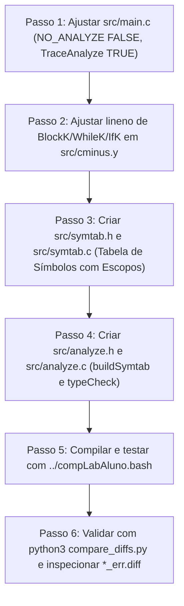

# Guia de Laboratório 3: Tabela de Símbolos e Análise Semântica para C-

Este documento apresenta um guia didático, minucioso e passo a passo para o desenvolvimento da **Tabela de Símbolos** e do **Analisador Semântico (e Verificador de Tipos)** da linguagem **C-** no âmbito da disciplina CTC-41 / CES-41 (Compiladores).

> ℹ️ **NOTA:**
> **Foco Exclusivo deste Laboratório:**
> Neste terceiro entregável, você deve manter funcionando a **Análise Léxica (Lab 1)** e a **Análise Sintática (Lab 2)** e implementar a **Construção da Tabela de Símbolos (`symtab.c` / `symtab.h`)** e a **Análise Semântica / Verificação de Tipos (`analyze.c` / `analyze.h`)**.
> A **Geração de Código** deve permanecer desativada nesta etapa (`NO_PARSE FALSE`, `NO_ANALYZE FALSE` e `NO_CODE TRUE`).

---

## 📑 Sumário

* [1. Visão Geral: O que é o Laboratório 3?](#1-visão-geral-o-que-é-o-laboratório-3)
* [2. O que o Professor Já Forneceu vs. O que Você Tem que Fazer de Novo](#2-o-que-o-professor-já-forneceu-vs-o-que-você-tem-que-fazer-de-novo)
  * [2.1 Resumo da Evolução entre os Laboratórios 1, 2 e 3](#21-resumo-da-evolução-entre-os-laboratórios-1-2-e-3)
* [3. Arquitetura da Análise Semântica: Os Dois Percursos na AST](#3-arquitetura-da-análise-semântica-os-dois-percursos-na-ast)
  * [3.1 Como Funciona o Percurso Genérico `traverse()` e os Callbacks `preProc` e `postProc`](#31-como-funciona-o-percurso-genérico-traverse-e-os-callbacks-preproc-e-postproc)
  * [3.2 Resumo Comparativo dos Dois Percursos (`buildSymtab` vs. `typeCheck`)](#32-resumo-comparativo-dos-dois-percursos-buildsymtab-vs-typecheck)
  * [3.3 A Ordem de Impressão no Arquivo `*_tab.txt` (Erros vs. Tabela)](#33-a-ordem-de-impressão-no-arquivo-_tabtxt-erros-vs-tabela)
* [4. A Tabela de Símbolos (`symtab.h` e `symtab.c`) em Detalhes](#4-a-tabela-de-símbolos-symtabh-e-symtabc-em-detalhes)
  * [4.1 O que Muda da Tabela do TINY para a Tabela do C-?](#41-o-que-muda-da-tabela-do-tiny-para-a-tabela-do-c-)
  * [4.2 As 3 Categorias de Escopo em C- e a Convenção de Nomes](#42-as-3-categorias-de-escopo-em-c--e-a-convenção-de-nomes)
  * [4.3 Pilha de Escopos Ativos e Sombreamento (*Shadowing*)](#43-pilha-de-escopos-ativos-e-sombreamento-shadowing)
  * [4.4 Exemplos Reais Mapeados Passo a Passo (`block2.cm`, `mdc2.cm`, `sort.cm`)](#44-exemplos-reais-mapeados-passo-a-passo-block2cm-mdc2cm-sortcm)
  * [4.5 Funções Pré-Definidas (`input` e `output`) e Regra de Números de Linha](#45-funções-pré-definidas-input-e-output-e-regra-de-números-de-linha)
  * [4.6 Formato Exato das Colunas em `printSymTab()`](#46-formato-exato-das-colunas-em-printsymtab)
* [5. Catálogo Completo dos 9 Erros Semânticos e de Tipos](#5-catálogo-completo-dos-9-erros-semânticos-e-de-tipos)
  * [5.1 Tabela Mestra de Mensagens de Erro Semântico](#51-tabela-mestra-de-mensagens-de-erro-semântico)
* [6. Ajuste Crucial no `src/cminus.y`: Linha Inicial de Blocos e Loops](#6-ajuste-crucial-no-srccminusy-linha-inicial-de-blocos-e-loops)
* [7. Roteiro Passo a Passo para Implementar o Lab 3](#7-roteiro-passo-a-passo-para-implementar-o-lab-3)
* [8. Como Compilar, Executar os Testes e Usar o `compare_diffs.py`](#8-como-compilar-executar-os-testes-e-usar-o-compare_diffspy)
* [9. Dicas Importantes e Pegadinhas Comuns](#9-dicas-importantes-e-pegadinhas-comuns)
* [10. Checklist Final do Lab 3](#10-checklist-final-do-lab-3)

---

## 1. Visão Geral: O que é o Laboratório 3?

Nos laboratórios anteriores, você construiu a frente estrutural do compilador:
* **Laboratório 1 (Scanner / Flex):** Transformou o código-fonte `.cm` em uma sequência de tokens.
* **Laboratório 2 (Parser / Bison):** Validou a gramática livre de contexto e construiu a **Árvore Sintática Abstrata (AST)** na memória.

Contudo, um programa pode ter **sintaxe 100% válida** e ainda assim ser **inválido ou sem sentido**. Por exemplo, o parser do Lab 2 aceita sem reclamar códigos como:
* `void a;` (declarar uma variável do tipo `void` — [`example/ser3_invalid_decl_void_variable.cm`](example/ser3_invalid_decl_void_variable.cm))
* `b = a;` quando `b` nunca foi declarado ([`example/ser1_variable_not_declared.cm`](example/ser1_variable_not_declared.cm))
* `a = exemplo();` quando `exemplo` retorna `void` ([`example/ser2_invalid_void_assignment.cm`](example/ser2_invalid_void_assignment.cm))
* Duas variáveis `int a; int a;` no mesmo escopo ([`example/ser4_variable_already_declared.cm`](example/ser4_variable_already_declared.cm))
* Um programa inteiro sem função `main` ([`example/ser6_main_undefined.cm`](example/ser6_main_undefined.cm))
* Uma função `int gdc(...)` que executa `return;` vazio sem devolver um inteiro ([`example/ser8_empty_return.cm`](example/ser8_empty_return.cm))

Todas essas regras dependem de **contexto** (saber o que foi declarado antes, em qual escopo, e com qual tipo). Verificá-las é o papel do **Laboratório 3 — Tabela de Símbolos e Análise Semântica**:

1. **Construir a Tabela de Símbolos (`symtab.c` / `symtab.h`):** Armazenar todos os identificadores do programa (funções, variáveis escalares, vetores e parâmetros), registrando seu **nome**, **escopo**, **tipo de identificador** (`fun`, `var`, `array`), **tipo de dado** (`int`, `void`) e a **lista de linhas** onde são declarados e referenciados.
2. **Gerenciar Múltiplos Escopos e Aninhamento:** Diferenciar variáveis globais (`""`), variáveis locais de funções (`"main"`, `"sort"`, `"teste"`) e variáveis declaradas dentro de blocos aninhados (`"teste:5"`, `"main:39"`, `"sort:22"`).
3. **Detectar Todos os Erros Semânticos e de Tipos (`analyze.c` / `analyze.h`):** Percorrer a AST emitindo mensagens precisas via `pce()` nos arquivos `*_err.txt` e `*_tab.txt`.
4. **Imprimir a Tabela de Símbolos Formatada:** Gerar a tabela alinhada em colunas nos arquivos `alunodetail/*_tab.txt`, validando-a contra o gabarito (`detail/*_tab.txt`) por meio do target `make ddiff` e do script [`compare_diffs.py`](compare_diffs.py).

---

## 2. O que o Professor Já Forneceu vs. O que Você Tem que Fazer de Novo

Veja o mapa completo dos arquivos do projeto e o que precisa ser criado ou modificado no Lab 3:

| Item / Arquivo | Origem | Situação Atual | O que você deve fazer no Lab 3? |
| :--- | :--- | :--- | :--- |
| **Infraestrutura CMake & Scripts**<br>([`CMakeLists.txt`](CMakeLists.txt), [`compLabAluno.bash`](compLabAluno.bash), [`killbuild`](killbuild), `scripts/*`) | **Professor** | 100% pronto e funcional | **NÃO MODIFICAR.** O `CMakeLists.txt` usa `FILE(GLOB labSrc ${CES41_SRC}/*.c)`, então qualquer `.c` criado em `src/` é compilado automaticamente. |
| **Validador de Tabela em Python**<br>([`compare_diffs.py`](compare_diffs.py)) | **Professor** | 100% pronto na raiz | **NÃO MODIFICAR.** Executar na raiz do projeto após `make ddiff` para validar os arquivos `*_tab.diff` independente da ordem das linhas. |
| **Biblioteca de Log**<br>([`lib/log.c`](lib/log.c), [`lib/log.h`](lib/log.h)) | **Professor** | 100% pronto | **NÃO MODIFICAR.** Usar `pc()` para imprimir a tabela e `pce()` para imprimir erros semânticos. |
| **Referência TINY**<br>([`TinyGeracaoCodigo/symtab.h`](TinyGeracaoCodigo/symtab.h), [`symtab.c`](TinyGeracaoCodigo/symtab.c), [`analyze.h`](TinyGeracaoCodigo/analyze.h), [`analyze.c`](TinyGeracaoCodigo/analyze.c)) | **Professor** | Exemplo da linguagem TINY | **NÃO MODIFICAR.** Servem como ponto de partida estrutural (função `hash`, listas de linhas e `traverse`), mas precisam ser expandidos em `src/` para suportar escopos, funções e arrays do C-. |
| **Scanner e Utilitários**<br>([`src/cminus.l`](src/cminus.l), [`src/util.c`](src/util.c), [`src/globals.h`](src/globals.h)) | **Você (Labs 1 e 2)** | Prontos | **MANTER** (ou adicionar campos auxiliares em `TreeNode` em `globals.h` se desejar). |
| **Parser Bison**<br>([`src/cminus.y`](src/cminus.y)) | **Você (Lab 2)** | Pronto para Lab 2 | **PEQUENO AJUSTE:** Garantir que nós `BlockK`, `WhileK`, `IfK` e `ReturnK` salvem o `lineno` do **início** do bloco/comando (e não do `}` final) para que escopos como `teste:5` e `sort:22` tenham a linha exata. |
| **Ponto de Entrada**<br>([`src/main.c`](src/main.c)) | **Misto** | `NO_ANALYZE TRUE` | **AJUSTAR:** Mudar `#define NO_ANALYZE FALSE` e ativar `int TraceAnalyze = TRUE;`. |
| **Tabela de Símbolos C-**<br>(`src/symtab.h`, `src/symtab.c`) | **Você (Lab 3)** | **NÃO EXISTEM EM `src/`** | **CRIAR:** Implementar a tabela hash com suporte a escopos (`""`, `func`, `func:linha`), tipos de ID (`var`, `array`, `fun`), tipos de dado (`int`, `void`) e `printSymTab()`. |
| **Analisador Semântico C-**<br>(`src/analyze.h`, `src/analyze.c`) | **Você (Lab 3)** | **NÃO EXISTEM EM `src/`** | **CRIAR:** Implementar `buildSymtab(syntaxTree)` e `typeCheck(syntaxTree)`, detectando os 9 tipos de erros semânticos. |

---

### 2.1 Resumo da Evolução entre os Laboratórios 1, 2 e 3

| Aspecto | Lab 1 (Léxico) | Lab 2 (Sintático) | Lab 3 (Tabela de Símbolos / Semântico) |
| :--- | :--- | :--- | :--- |
| **Arquivos Principais** | `src/cminus.l` | `src/cminus.y`, `src/util.c` | **`src/symtab.c`**, **`src/symtab.h`**, **`src/analyze.c`**, **`src/analyze.h`** |
| **Macros em `main.c`** | `NO_PARSE TRUE` | `NO_PARSE FALSE`<br>`NO_ANALYZE TRUE`<br>`NO_CODE TRUE` | `NO_PARSE FALSE`<br>**`NO_ANALYZE FALSE`**<br>`NO_CODE TRUE` |
| **Flags de Trace em `main.c`** | `TraceScan = TRUE` | `TraceParse = TRUE` | `TraceParse = TRUE`<br>**`TraceAnalyze = TRUE`** |
| **Transição de Log em `main.c`** | `initializePrinter(..., LER)` | `doneLEXstartSYN()` | **`doneSYNstartTAB()`** (passa a gravar em `*_tab.txt`) |
| **Script de Compilação** | `compLabAlunoLEX.bash` | `compLabAluno.bash` | **`compLabAluno.bash`** + **`python3 compare_diffs.py`** |
| **Arquivos Avaliados** | `*_lex.diff`, `*_err.diff` | `*_syn.diff`, `*_err.diff` | `*_lex.diff`, `*_syn.diff`, **`*_tab.diff`** e **`*_err.diff`** |

---

## 3. Arquitetura da Análise Semântica: Os Dois Percursos na AST

No arquivo [`src/main.c`](src/main.c), logo após a impressão da árvore sintática, o compilador muda a chave do logger para o arquivo `TAB` (`doneSYNstartTAB()`) e executa duas funções em sequência:

```c
#if !NO_ANALYZE
  doneSYNstartTAB(); // SyntaxTree analysis ended. Now, print on TAB output file
  if (! Error)
  { if (TraceAnalyze) fprintf(listing,"\nBuilding Symbol Table...\n");
    buildSymtab(syntaxTree);
    if (TraceAnalyze) fprintf(listing,"\nChecking Types...\n");
    typeCheck(syntaxTree);
    if (TraceAnalyze) fprintf(listing,"\nType Checking Finished\n");
  }
```

### Qual é a finalidade de `buildSymtab()` e `typeCheck()` e quais erros cada uma captura?

As duas funções dividem a responsabilidade da Análise Semântica em **duas passagens complementares** sobre a AST:

1. **`buildSymtab(syntaxTree)` — Construção da Tabela de Símbolos e Verificação de Escopos (1º Percurso):**
   * **Finalidade:** Percorrer a árvore sintática para **registrar todas as declarações** (funções, parâmetros, variáveis escalares e vetores) na Tabela de Símbolos dentro de seus respectivos escopos (`""`, `<funcao>`, `<funcao>:<linha>`), **vincular cada uso de variável** à sua declaração correspondente na pilha de escopos (adicionando o número da linha em que foi usada) e **verificar se a função `main` existe**.
   * **Erros que `buildSymtab` captura (6 categorias de erro):**
     * **Variável declarada como `void`** (`void a;` — [`ser3_invalid_decl_void_variable.cm`](example/ser3_invalid_decl_void_variable.cm)): detectado no instante da declaração ao verificar que `t->type == Void`.
     * **Variável redeclarada no mesmo escopo** (`int a; int a;` — [`ser4_variable_already_declared.cm`](example/ser4_variable_already_declared.cm)): detectado ao tentar inserir uma variável cujo nome já existe no escopo atual (topo da pilha).
     * **Nome de função usado para declarar variável** (`int xyz(void)... int xyz;` — [`ser7_variable_name_used_for_function.cm`](example/ser7_variable_name_used_for_function.cm)): detectado ao verificar que o nome da variável já está registrado no escopo global como uma função (`fun`).
     * **Função redeclarada** (duas funções `int funTwo(void)` — [`ser9_function_redeclared.cm`](example/ser9_function_redeclared.cm)): detectado ao tentar declarar uma função cujo nome já existe no escopo global.
     * **Variável não declarada no escopo** (`b = a;` sem declarar `b` — [`ser1_variable_not_declared.cm`](example/ser1_variable_not_declared.cm)): detectado ao buscar uma variável (em `IdK`, `AssignK` ou `AssignArrK`) do escopo mais interno até o global e não encontrá-la.
     * **Função `main` não definida** ([`ser6_main_undefined.cm`](example/ser6_main_undefined.cm), [`ser1_variable_not_declared.cm`](example/ser1_variable_not_declared.cm) e [`function_call_array_testcode.cm`](example/function_call_array_testcode.cm)): detectado ao final de `buildSymtab()`, quando todas as declarações globais já foram lidas e `"main"` não consta no escopo global.

2. **`typeCheck(syntaxTree)` — Verificação de Tipos, Chamadas de Função e Retornos (2º Percurso):**
   * **Finalidade:** Com a Tabela de Símbolos já **100% construída**, percorrer a árvore novamente para **validar chamadas de função**, **calcular e propagar os tipos (`Integer`, `Void`, `Boolean`)** das subexpressões (dos nós filhos para os nós pais) e **checar regras de tipos em atribuições, operações e comandos `return`**. Ao final, imprime a Tabela de Símbolos completa.
   * **Erros que `typeCheck` captura (3 categorias de erro):**
     * **Chamada a função não declarada** (`a = fun();` ou `g(v[3], 3)` — [`ser5_function_not_declared.cm`](example/ser5_function_not_declared.cm) e [`function_call_array_testcode.cm`](example/function_call_array_testcode.cm)): verificado neste 2º percurso pois todas as funções do programa já foram cadastradas na tabela durante o 1º percurso; se o nome no nó `CallK` não existir no escopo global, emite o erro.
     * **Atribuição ou uso inválido de expressão `void`** (`a = exemplo();` onde `exemplo` retorna `void` — [`ser2_invalid_void_assignment.cm`](example/ser2_invalid_void_assignment.cm)): o nó `CallK` consulta a tabela, descobre que `exemplo` tem tipo de retorno `Void`, anota `t->type = Void` em si mesmo e, ao subir para o nó pai (`AssignK` / `AssignArrK`), o verificador detecta que uma expressão `Void` está sendo atribuída a uma variável inteira.
     * **Retorno vazio (`return;`) em função do tipo `int`** ([`ser8_empty_return.cm`](example/ser8_empty_return.cm)): verifica se um comando `ReturnK` sem expressão (`t->child[0] == NULL`) aparece dentro de uma função declarada com tipo de retorno `Integer` (`int`).

> 📌 **IMPORTANTE:**
> **Por que `typeCheck()` roda mesmo quando `buildSymtab()` encontra erro?**
> Observe no trecho do `main.c` acima que a condição `if (! Error)` é verificada **uma única vez antes de `buildSymtab(syntaxTree)`** (para pular a análise semântica apenas se houve erro léxico ou sintático).
> Mesmo que `buildSymtab()` encontre um erro semântico e faça `Error = TRUE`, a função `typeCheck(syntaxTree)` **ainda é executada logo em seguida**! Isso é intencional e indispensável: no caso de teste [`example/function_call_array_testcode.cm`](example/function_call_array_testcode.cm), o 1º erro (`Semantic error: undefined reference to 'main'`) é capturado no fim de `buildSymtab()` e o 2º erro (`Semantic error at line 7: 'g' was not declared in this scope`) é capturado logo depois por `typeCheck()`.

---

### 3.1 Como Funciona o Percurso Genérico `traverse()` e os Callbacks `preProc` e `postProc`

Tanto `buildSymtab` quanto `typeCheck` percorrem a Árvore Sintática Abstrata usando a função recursiva `traverse` (presente em [`TinyGeracaoCodigo/analyze.c`](TinyGeracaoCodigo/analyze.c)):

```c
static void traverse( TreeNode * t,
               void (* preProc) (TreeNode *),
               void (* postProc) (TreeNode *) )
{ if (t != NULL)
  { preProc(t);
    { int i;
       for (i=0; i < MAXCHILDREN; i++)
        traverse(t->child[i],preProc,postProc);
    }
    postProc(t);
    traverse(t->sibling,preProc,postProc);
  }
}
```

#### O que são `preProc` e `postProc`?

Os parâmetros `void (* preProc) (TreeNode *)` e `void (* postProc) (TreeNode *)` são **ponteiros para funções (*callbacks*)** que você passa para `traverse()`. Graças a eles, você não precisa escrever vários loops recursivos diferentes para caminhar na árvore: `traverse()` cuida de toda a navegação por `child[0..2]` e `sibling`, e chama as suas funções `preProc(t)` e `postProc(t)` em **dois momentos estrategicamente opostos** da visita a cada nó `t`:

1. **`preProc(t)` — Ação em Pré-Ordem (Na ENTRADA do nó / *Top-Down*):**
   * **Quando executa:** Na linha `preProc(t);`, **imediatamente ao chegar no nó `t`**, **ANTES** do laço `for` descer para visitar os filhos (`t->child[0]`, `t->child[1]`, `t->child[2]`) e **ANTES** de visitar o irmão (`t->sibling`).
   * **Qual a sua funcionalidade prática:**
     * **No 1º Percurso (`buildSymtab`):**
       * **Empilhar escopos (`st_push_scope`):** Quando `t` é uma função (`FunctionK`), um bloco `{ ... }` (`BlockK`) ou um `while` (`WhileK`), `preProc(t)` abre e empilha o novo escopo (ex: `"teste"` ou `"teste:5"`). Como isso acontece **antes** de visitar `t->child[i]`, todos os parâmetros, variáveis e comandos filhos daquele bloco serão processados já dentro do novo escopo!
       * **Cadastrar declarações e usos na tabela (`insertNode`):** Processa declarações de funções, parâmetros e variáveis de cima para baixo na ordem em que aparecem no código, e registra as linhas de uso em `IdK`, `AssignK`, `AssignArrK` e `CallK`.
     * **No 2º Percurso (`typeCheck`):**
       * **Rastrear a função atual:** Ao entrar em um `FunctionK`, guarda o tipo de retorno da função (`currentFuncReturnType = t->type`) em uma variável estática para que, quando a recursão descer para os filhos e encontrar um `ReturnK`, saiba se aquela função exige retorno `int` ou `void`.

2. **`postProc(t)` — Ação em Pós-Ordem (Na SAÍDA da subárvore / *Bottom-Up*):**
   * **Quando executa:** Na linha `postProc(t);`, **DEPOIS** que o laço `for` terminou de visitar recursivamente **todos os filhos (`t->child[0..2]`) e netos** de `t`, mas **ANTES** da chamada `traverse(t->sibling, ...)` que avança para o próximo nó irmão no mesmo nível!
   * **Qual a sua funcionalidade prática:**
     * **No 1º Percurso (`buildSymtab`):**
       * **Desempilhar escopos (`st_pop_scope`):** Quando `t` é um `FunctionK`, `BlockK` ou `WhileK`, a execução de `postProc(t)` significa que o corpo inteiro da função ou do bloco já terminou de ser analisado. Portanto, `postProc(t)` fecha (desempilha) o escopo daquele bloco/função, restaurando o escopo pai **antes** que `traverse(t->sibling)` visite o próximo comando ou a próxima função!
     * **No 2º Percurso (`typeCheck` — função `checkNode`):**
       * **Propagar e verificar tipos de baixo para cima (*Bottom-Up*):** Para verificar o tipo de uma expressão composta (ex: `a = x + exemplo()`), você precisa **primeiro** determinar os tipos dos nós folhas (`x` é `Integer`, `exemplo()` é `Void`), depois o tipo da operação soma (`+`), e só então verificar a atribuição (`=`). Como `postProc(t)` só roda no nó pai **depois** que `postProc` já rodou em todos os seus filhos `t->child[i]`, no momento em que `checkNode(t)` executa em um nó `OpK`, `AssignK` ou `ReturnK`, os tipos `t->child[0]->type` e `t->child[1]->type` **já estão prontos e calculados**!

3. **`nullProc(t)` — Função Vazia Auxiliar:**
   * Caso um percurso precisasse agir apenas na ida (`preProc`) ou apenas na volta (`postProc`), `TinyGeracaoCodigo/analyze.c` define uma função vazia `static void nullProc(TreeNode * t) { return; }` para passar no lugar do callback não utilizado. No entanto, em C-, como precisamos empilhar escopos/rastrear funções na entrada (`preProc`) e desempilhar escopos/checar tipos na saída (`postProc`), **usamos funções ativas tanto em `preProc` quanto em `postProc` nos dois percursos**!

Veja visualmente o ciclo de vida completo de uma chamada `traverse(t, preProc, postProc)`:

```
                       ┌──────────────────────┐
                       │   Chegou no nó t     │
                       └──────────┬───────────┘
                                  │
                                  ▼
                    1. Executa preProc(t)  ◄── ANTES dos filhos (Top-Down):
                       • No 1º percurso: insere declaração/uso na tabela e
                         EMPILHA novo escopo se t for FunctionK, BlockK ou WhileK.
                       • No 2º percurso: salva o tipo da função atual se t for FunctionK.
                                  │
                                  ▼
                    2. Laço for: visita recursivamente child[0], child[1], child[2]
                       (toda a subárvore filha roda dentro do escopo empilhado no passo 1!)
                                  │
                                  ▼
                    3. Executa postProc(t) ◄── DEPOIS dos filhos, ANTES do irmão (Bottom-Up):
                       • No 1º percurso: DESEMPILHA o escopo se t for FunctionK, BlockK ou WhileK.
                       • No 2º percurso: filhos já têm tipo calculado! Calcula t->type e
                         verifica erros de tipo (void em AssignK, return vazio em ReturnK).
                                  │
                                  ▼
                    4. Avança para o irmão: traverse(t->sibling, preProc, postProc)
                       (já de volta ao escopo pai original!)
```

> 💡 **DICA:**
> **Por que o par `(preProc, postProc)` funciona tão bem para escopos?**
> Porque irmãos (`t->sibling`) são visitados **depois** de `postProc(t)`!
> Isso significa que quando você empilha o escopo `"teste"` no `preProc` de um nó `FunctionK`:
> * Os parâmetros (`child[0]`) e o corpo da função (`child[1]`) são visitados enquanto `"teste"` está no topo da pilha.
> * No `postProc` do `FunctionK`, você desempilha `"teste"`, voltando ao escopo global `""`.
> * Em seguida, `traverse(t->sibling)` visita a próxima função (`main`) já no escopo global `""`!
> O mesmo vale para um `BlockK` (`{ ... }`) ou `WhileK`: o escopo interno (ex: `"teste:5"` ou `"sort:22"`) fica ativo apenas para os filhos daquele bloco e é desempilhado antes de seguir para o próximo comando irmão!

---

### 3.2 Resumo Comparativo dos Dois Percursos (`buildSymtab` vs. `typeCheck`)

Conforme explicado pelo professor nas instruções oficiais ([`instructions/regras_versoes260812.txt`](instructions/regras_versoes260812.txt)), veja o quadro-resumo do que ocorre em cada percurso:

| Percurso | Função Principal | Callbacks em `traverse` | Resumo das Ações | Erros Capturados |
| :--- | :--- | :--- | :--- | :--- |
| **1º Percurso** | `buildSymtab(syntaxTree)` | • `preProc`: `insertNode`<br>• `postProc`: `leaveScope` | 1. Chama `st_init()` para limpar a tabela e pré-cadastrar `input` e `output` no escopo global `""`.<br>2. Empilha escopos na entrada (`preProc`) e desempilha na saída (`postProc`) de `FunctionK`, `BlockK`, `WhileK` e `IfK`.<br>3. Cadastra declarações (`FunctionK`, `VarDeclK`, `VarDeclArrK`, `ParamK`, `ParamArrK`).<br>4. Busca variáveis usadas (`IdK`, `AssignK`, `AssignArrK`) na pilha de escopos e adiciona a linha de uso.<br>5. **Após `traverse`**: checa se `"main"` existe no escopo global. | • `ser3`: variável `void`<br>• `ser4`: variável redeclarada no mesmo escopo<br>• `ser7`: variável com nome de função<br>• `ser9`: função redeclarada<br>• `ser1`: variável não declarada<br>• `ser6`: `main` não definida |
| **2º Percurso** | `typeCheck(syntaxTree)` | • `preProc`: `preCheckNode`<br>• `postProc`: `checkNode` | 1. Rastreia em `preProc` o tipo de retorno da função atual (`FunctionK`).<br>2. Em `postProc`, valida chamadas `CallK` no escopo global, registra a linha de chamada na tabela e anota `t->type` com o tipo de retorno da função.<br>3. Propaga `t->type = Integer` em `ConstK` e `OpK`.<br>4. Checa se `AssignK` / `AssignArrK` recebem expressão `Void`.<br>5. Checa se `ReturnK` está vazio dentro de função `Integer`.<br>6. **Após `traverse`**: imprime `\nSymbol table:\n\n` e chama `printSymTab()`. | • `ser5` / `function_call_array`: função chamada não declarada<br>• `ser2`: atribuição de expressão `void`<br>• `ser8`: `return;` vazio em função `int` |

---

### 3.3 A Ordem de Impressão no Arquivo `*_tab.txt` (Erros vs. Tabela)

Se você inspecionar qualquer arquivo de erro semântico no gabarito (por exemplo, [`detail/ser2_invalid_void_assignment_tab.txt`](detail/ser2_invalid_void_assignment_tab.txt) ou [`detail/function_call_array_testcode_tab.txt`](detail/function_call_array_testcode_tab.txt)), verá que **todas as mensagens de erro semântico aparecem no topo do arquivo `*_tab.txt`, ANTES do cabeçalho `Symbol table:`**:

```text
Semantic error: undefined reference to 'main'
Semantic error at line 7: 'g' was not declared in this scope

Symbol table:

Variable Name  Scope     ID Type  Data Type  Line Numbers
-------------  --------  -------  ---------  -------------------------
input                    fun      int        
f                        fun      int         6 
output                   fun      void       
u              f         var      int         6  7 
v              f         array    int         6  7 
```

**Por que isso acontece no gabarito?**
No compilador TINY original ([`TinyGeracaoCodigo/analyze.c`](TinyGeracaoCodigo/analyze.c)), `printSymTab()` era chamado dentro de `buildSymtab()`, antes de `typeCheck()`. Porém, no gabarito de C-, a impressão da tabela (`pc("\nSymbol table:\n\n"); printSymTab();`) é feita **após os dois percursos terminarem** (isto é, no final de `typeCheck()`, ou executando a verificação antes de imprimir a tabela).

> 💡 **DICA:**
> **Recomendação Prática:**
> Coloque o bloco:
> ```c
> if (TraceAnalyze) {
>     pc("\nSymbol table:\n\n");
>     printSymTab();
> }
> ```
> **no final da função `typeCheck()`** (em vez do final de `buildSymtab()`).
> Assim, tanto os erros do 1º percurso quanto os erros do 2º percurso serão impressos **antes** da tabela de símbolos no arquivo `*_tab.txt`, deixando a sua saída 100% alinhada com o gabarito!
> *(Nota: O professor também explica na Seção 4 das instruções que, mesmo se a mensagem de erro saísse depois da tabela em `*_tab.txt`, o script `compare_diffs.py` compara conjuntos de linhas e continuaria dando `OK`, mas colocar `printSymTab()` no final de `typeCheck()` já evita qualquer diferença de posição!)*

---

## 4. A Tabela de Símbolos (`symtab.h` e `symtab.c`) em Detalhes

### 4.1 O que Muda da Tabela do TINY para a Tabela do C-?

No compilador TINY ([`TinyGeracaoCodigo/symtab.c`](TinyGeracaoCodigo/symtab.c)), a tabela de símbolos era extremamente simples porque TINY não tinha funções, nem vetores, nem tipos (`void` vs `int`), nem blocos de escopo:

| Característica | Tabela do TINY (`TinyGeracaoCodigo/symtab.c`) | Tabela do C- (`src/symtab.c`) |
| :--- | :--- | :--- |
| **Colunas Impressas** | `Variable Name`, `Location`, `Line Numbers` | `Variable Name`, **`Scope`**, **`ID Type`**, **`Data Type`**, `Line Numbers` |
| **Escopos** | Único (todas as variáveis eram globais) | **Múltiplos escopos** (`""`, `<func>`, `<func>:<linha>`) organizados em pilha |
| **Tipos de Identificador (`ID Type`)** | Apenas variáveis simples | **`var`** (variável escalar), **`array`** (vetor), **`fun`** (função) |
| **Tipos de Dado (`Data Type`)** | Apenas inteiro implícito | **`int`** e **`void`** |
| **Funções Nativas** | Nenhuma (`read` e `write` eram palavras-chave) | **`input`** (`fun`, `int`) e **`output`** (`fun`, `void`) pré-inseridas no escopo global `""` |
| **Duplicação na Mesma Linha** | Adicionava o mesmo número de linha repetidas vezes | **Não repete** o número de linha se o identificador aparecer mais de uma vez na mesma linha |

---

### 4.2 As 3 Categorias de Escopo em C- e a Convenção de Nomes

Na coluna `Scope` da tabela de símbolos do gabarito (`detail/*_tab.txt`), existem exatamente **3 formatos de escopo**:

1. **Escopo Global (`""` — string vazia):**
   * Na tabela impressa, a coluna `Scope` fica em branco (10 espaços).
   * Quem pertence ao escopo global:
     * Todas as **funções** declaradas no programa (`main`, `gdc`, `sort`, `minloc`, `binario`, `teste`, etc.).
     * As funções nativas **`input`** e **`output`**.
     * **Variáveis e vetores globais** declarados fora de qualquer função (como `int global;` em [`example/atualizaglobal_testcode.cm`](example/atualizaglobal_testcode.cm) e `int x[10];` em [`example/sort.cm`](example/sort.cm)).

2. **Escopo de Função (`"<nome_da_funcao>"`):**
   * Exemplos: `"main"`, `"gdc"`, `"sort"`, `"minloc"`, `"teste"`, `"binario"`, `"atualizaglobal"`.
   * Quem pertence ao escopo da função:
     * Os **parâmetros** da função (`ParamK` como `var`, e `ParamArrK` como `array`).
     * As **variáveis e vetores locais** declarados diretamente no corpo principal da função.

3. **Escopo de Bloco Aninhado (`"<nome_da_funcao>:<linha_inicio>"`):**
   * Exemplos presentes no gabarito:
     * `"teste:5"` em [`detail/block2_tab.txt`](detail/block2_tab.txt) (bloco `{` iniciado na linha 5 dentro da função `teste`).
     * `"teste:6"` em [`detail/block2_nointerc_tab.txt`](detail/block2_nointerc_tab.txt) (bloco `{` iniciado na linha 6 dentro da função `teste`).
     * `"main:39"` em [`detail/mdc2_tab.txt`](detail/mdc2_tab.txt) (bloco `{` iniciado na linha 39 dentro da função `main`).
     * `"sort:22"` em [`detail/sort_tab.txt`](detail/sort_tab.txt) (corpo do `while` iniciado na linha 22 dentro da função `sort`, onde é declarada a variável `int t;` na linha 23).
   * Como o nome é formado: `<nome_da_funcao_atual>:<lineno_inicio_do_bloco>`.

> 📌 **IMPORTANTE:**
> **Atenção ao caso `sort:22` em `sort_tab.txt`!**
> Em [`example/sort.cm`](example/sort.cm), a linha 22 é `while(i < high - 1 ) {` e a linha 23 é `int t;`.
> Na árvore sintática ([`detail/sort_syn.txt`](detail/sort_syn.txt)), o corpo do `while` **não** gera um nó `Block:` explícito (o nó na AST é apenas `WhileK`, impresso como `Iteration (loop)`).
> Porém, na tabela de símbolos ([`detail/sort_tab.txt`](detail/sort_tab.txt)), a variável `t` declarada dentro do `while` recebe o escopo **`sort:22`**!
> Portanto, no seu analisador semântico (`analyze.c`), você deve empilhar um novo escopo `<funcao>:<lineno>` **tanto ao entrar em um nó `BlockK` quanto ao entrar em um nó `WhileK` (e `IfK`)**! Se nenhuma variável for declarada dentro de um `while` ou `if`, nenhuma entrada com aquele escopo será criada na tabela, então não afetará outros testes; mas quando houver uma declaração interna (como `int t;` em `sort.cm`), ela ficará exatamente no escopo `sort:22`!

---

### 4.3 Pilha de Escopos Ativos e Sombreamento (*Shadowing*)

Em C- (com as extensões de blocos aninhados), uma variável local pode ter o **mesmo nome** de uma variável de um escopo mais externo (por exemplo, uma variável `x` em `minloc` sombreando o vetor global `x[10]` em `sort.cm`, ou `int a;` dentro do bloco `teste:5` sombreando o parâmetro `int a` da função `teste` em `block2.cm`).

Para resolver isso corretamente, você precisa distinguir duas operações de busca (*lookup*) na Tabela de Símbolos:

```
              PILHA DE ESCOPOS ATIVOS (Ex: dentro do bloco da linha 5 de teste)

       Topo da Pilha (Escopo Atual) ──► ┌─────────────────────────┐
                                        │ Escopo: "teste:5"       │  ◄── 1º lugar buscado
                                        │ Variáveis: a (l.5), b   │
                                        └────────────┬────────────┘
                                                     │ parent
                                                     ▼
                                        ┌─────────────────────────┐
                                        │ Escopo: "teste"         │  ◄── 2º lugar buscado
                                        │ Variáveis: b (l.2), a   │
                                        └────────────┬────────────┘
                                                     │ parent
                                                     ▼
       Base da Pilha (Escopo Global) ─► ┌─────────────────────────┐
                                        │ Escopo: "" (Global)     │  ◄── 3º lugar buscado
                                        │ Funções: input, output, │
                                        │          teste, main    │
                                        └─────────────────────────┘
```

1. **Busca no Escopo Atual Apenas (`st_lookup_current_scope(name)`):**
   * **Quando usar:** No momento de **declarar** uma nova variável ou parâmetro (`VarDeclK`, `VarDeclArrK`, `ParamK`, `ParamArrK`).
   * **Por quê?** Porque se `a` já existe em `"teste"`, declarar `int a;` dentro de `"teste:5"` **é permitido** (cria uma nova entrada para `a` com escopo `"teste:5"`). Só é erro de redeclaração (`'a' was already declared as a variable`) se `a` já existir **exatamente no escopo atual** (no topo da pilha)!
   * *(Lembre-se também de checar se `name` já não foi declarado como `fun` no escopo global `""`, para capturar o erro `ser7`: `'xyz' was already declared as a function`).*

2. **Busca Hierárquica na Pilha de Escopos (`st_lookup_all_scopes(name)`):**
   * **Quando usar:** No momento de **usar ou atribuir** a uma variável (`IdK`, `AssignK`, `AssignArrK`).
   * **Como funciona:** Começa procurando `name` no escopo do **topo da pilha** (escopo mais interno, ex: `"teste:5"`).
     * Se encontrar, retorna essa entrada (e adiciona a linha atual nela).
     * Se não encontrar, desce para o escopo pai (`"teste"`).
     * Se não encontrar, desce até o escopo global (`""`).
     * Se não encontrar em nenhum escopo da pilha ativa, a variável **não foi declarada neste escopo** (`Semantic error at line %d: '%s' was not declared in this scope`).

---

### 4.4 Exemplos Reais Mapeados Passo a Passo (`block2.cm`, `mdc2.cm`, `sort.cm`)

Veja como essa regra de pilha de escopos explica perfeitamente os números de linha do gabarito:

#### Exemplo A: `block2.cm` (`teste` vs. `teste:5`)
```c
 2: void teste (int b, int a) {
 3:   output(a);
 4:   output(b);
 5:   { int a;
 6:     a = 3;
 7:     int b;
 8:     b = 4;
 9:     output(a);
10:     output(b);
11:   }
12:   a = 5;
13:   output(a);
14: }
```
* **Linha 2:** `b` e `a` são parâmetros inseridos no escopo `"teste"` (linhas: `2`).
* **Linhas 3 e 4:** `output(a)` e `output(b)` buscam `a` e `b` no escopo ativo `"teste"` → `a` em `"teste"` fica com `2  3`; `b` em `"teste"` fica com `2  4`.
* **Linha 5:** Entra no `BlockK` iniciado na linha 5 → empilha o escopo `"teste:5"`.
  * `int a;` na linha 5 insere uma **nova** variável `a` no escopo `"teste:5"` (linha: `5`).
  * `a = 3;` na linha 6 e `output(a);` na linha 9 buscam `a` a partir do topo da pilha e encontram `a` de `"teste:5"` → `a` em `"teste:5"` fica com `5  6  9`.
  * `int b;` na linha 7, `b = 4;` na linha 8 e `output(b);` na linha 10 criam e atualizam `b` em `"teste:5"` → `7  8 10`.
* **Linha 11:** Sai do `BlockK` → desempilha `"teste:5"`. O topo da pilha volta a ser `"teste"`.
* **Linhas 12 e 13:** `a = 5;` e `output(a);` buscam `a` no topo da pilha (`"teste"`) → `a` em `"teste"` recebe as linhas `12` e `13`, terminando com `2  3 12 13`!

Resultado em [`detail/block2_tab.txt`](detail/block2_tab.txt):
```text
a              teste:5   var      int         5  6  9 
b              teste:5   var      int         7  8 10 
a              teste     var      int         2  3 12 13 
b              teste     var      int         2  4 
```

#### Exemplo B: `mdc2.cm` (Acesso a Variável Externa a partir de Bloco Interno)
```c
33:     int y;
34:     y = 0;
35:     int x;
37:     int res;
38:     res=0;
39:     { 
40:         int y;
41:         x = input();
42:         y = input();
43:         y = gdc(x,y);
44:         res = y;
45:         output(res);
46:     }
47:     if (res >= 0) binario(res+y);
48:     else binario(-res+y);
```
* Dentro do bloco `main:39` (linhas 39 a 46):
  * `y` foi redeclarado na linha 40, então toda referência a `y` nas linhas 42, 43 e 44 resolve para `y` de **`main:39`** (`40 42 43 44`).
  * Já `x` e `res` **não** foram redeclarados em `main:39`! Quando `x = input();` (linha 41) ou `res = y;` (linha 44) são executados dentro do bloco, a busca começa em `main:39`, não acha, desce para o escopo pai `main`, encontra `x` e `res` em **`main`**, e adiciona as linhas `41, 43` em `x` (`main`) e `44, 45` em `res` (`main`)!
  * Ao sair do bloco nas linhas 47 e 48, `y` volta a resolver para o `y` de **`main`** (`33 34 47 48`).

---

### 4.5 Funções Pré-Definidas (`input` e `output`) e Regra de Números de Linha

1. **Pré-cadastro de `input` e `output`:**
   * Antes de iniciar o percurso na árvore sintática em `buildSymtab()`, você deve inserir na tabela de símbolos (no escopo global `""`):
     * `input`: `ID Type = "fun"`, `Data Type = Integer` (`"int"`), **sem linhas iniciais** (`lines = NULL`).
     * `output`: `ID Type = "fun"`, `Data Type = Void` (`"void"`), **sem linhas iniciais** (`lines = NULL`).
   * Assim, como exigido pelo gabarito, `input` e `output` sempre aparecem na tabela de todos os programas. Se o programa nunca chamar `input()`, a coluna `Line Numbers` de `input` ficará vazia; se chamar `input()` na linha 13, a linha `13` será adicionada normalmente à lista de linhas de `input`.

2. **Não Duplicar o Mesmo Número de Linha Consecutivo:**
   * Em [`example/mdc.cm`](example/mdc.cm), a linha 6 é:
     ```c
     else return gdc(v,u-u/v*v);
     ```
     Aqui, `v` aparece **3 vezes** na linha 6 e `u` aparece **2 vezes** na linha 6.
   * Porém, em [`detail/mdc_tab.txt`](detail/mdc_tab.txt), as linhas de `u` e `v` são registradas apenas uma vez por linha de código:
     ```text
     u              gdc       var      int         3  5  6 
     v              gdc       var      int         3  5  6 
     ```
   * Da mesma forma, em [`example/sort.cm`](example/sort.cm), a linha 35 tem 5 atribuições na mesma linha (`x[0] = 1; x[1] = -2; ...`), mas a linha `35` aparece **apenas uma vez** em [`detail/sort_tab.txt`](detail/sort_tab.txt).
   * Portanto, a regra da tabela é simples: se um identificador for referenciado várias vezes na mesma linha, aquele número de linha deve ser anotado **uma única vez** (veremos como implementar isso no **Passo 3 do Roteiro**, na Seção 7).

---

### 4.6 Formato Exato das Colunas em `printSymTab()`

O script [`compare_diffs.py`](compare_diffs.py) compara cada linha da sua tabela com a linha correspondente do gabarito usando igualdade exata de strings (`coming == going` após o `diff -ZbB`). Por isso, o cabeçalho e o alinhamento das 5 colunas devem seguir exatamente o padrão do gabarito:

```c
pc("Variable Name  Scope     ID Type  Data Type  Line Numbers\n");
pc("-------------  --------  -------  ---------  -------------------------\n");
```

E para cada símbolo armazenado na tabela:

```c
pc("%-14s ", l->name);       /* Coluna 1: Nome (14 chars alinhado à esq + 1 espaço = 15 chars) */
pc("%-10s", l->scope);       /* Coluna 2: Escopo (10 chars alinhado à esq, SEM espaço extra)   */
pc("%-9s", l->idTypeStr);    /* Coluna 3: "fun", "var" ou "array" (9 chars alinhado à esq)     */
pc("%-11s", l->dataTypeStr); /* Coluna 4: "int" ou "void" (11 chars alinhado à esq)            */

LineList t = l->lines;
while (t != NULL) {
    pc("%2d ", t->lineno);   /* Coluna 5: Números de linha com "%2d " (2 dígitos + 1 espaço)   */
    t = t->next;
}
pc("\n");
```

> ℹ️ **NOTA:**
> **Curiosidade do Gabarito Explicada (`%-10s` na Coluna `Scope`):**
> Se você olhar a linha 12 de [`detail/atualizaglobal_testcode_tab.txt`](detail/atualizaglobal_testcode_tab.txt), verá:
> ```text
> i              atualizaglobalvar      int         7  8 
> ```
> Repare que `atualizaglobal` (14 caracteres) grudou em `var` (`atualizaglobalvar`)!
> Por quê? Porque o gabarito usou exatamente `pc("%-10s", scope)` sem espaço fixo depois! Quando o nome do escopo tem menos de 10 caracteres (ex: `"main"`, `"sort:22"`), `%-10s` preenche com espaços até 10 colunas; quando tem 14 caracteres (`"atualizaglobal"`), `%-10s` imprime os 14 caracteres sem espaço adicional e já imprime `"var      "` logo em seguida. Usar `pc("%-10s", l->scope)` reproduz esse comportamento com 100% de fidelidade!

---

## 5. Catálogo Completo dos 9 Erros Semânticos e de Tipos

Todos os erros semânticos e de tipos nos casos de teste da pasta `example/` devem ser impressos com **`pce()`** (para que sejam gravados tanto em `*_tab.txt` quanto em `*_err.txt`) e devem setar `Error = TRUE;`.

### 5.1 Tabela Mestra de Mensagens de Erro Semântico

| # | Caso de Teste (`example/*.cm`) | Quando o Erro Ocorre | Percurso | Mensagem Exata no Gabarito (`pce`) |
| :-: | :--- | :--- | :-: | :--- |
| **1** | [`ser1_variable_not_declared.cm`](example/ser1_variable_not_declared.cm) | Uso ou atribuição a uma variável que não foi declarada no escopo atual nem nos escopos pais/global. | 1º (`buildSymtab`) | `pce("Semantic error at line %d: '%s' was not declared in this scope\n", t->lineno, t->attr.name);` |
| **2** | [`ser2_invalid_void_assignment.cm`](example/ser2_invalid_void_assignment.cm) | Atribuição (ou operação) cujo lado direito é uma expressão de tipo `Void` (ex: retorno de função `void`). | 2º (`typeCheck`) | `pce("Semantic error at line %d: invalid use of void expression\n", t->lineno);` |
| **3** | [`ser3_invalid_decl_void_variable.cm`](example/ser3_invalid_decl_void_variable.cm) | Declaração de variável (ou vetor/parâmetro) com especificador de tipo `void` (ex: `void a;`). | 1º (`buildSymtab`) | `pce("Semantic error at line %d: variable declared void\n", t->lineno);` |
| **4** | [`ser4_variable_already_declared.cm`](example/ser4_variable_already_declared.cm) | Declaração de variável cujo nome já foi declarado anteriormente **no mesmo escopo**. | 1º (`buildSymtab`) | `pce("Semantic error at line %d: '%s' was already declared as a variable\n", t->lineno, t->attr.name);` |
| **5** | [`ser5_function_not_declared.cm`](example/ser5_function_not_declared.cm)<br>[`function_call_array_testcode.cm`](example/function_call_array_testcode.cm) | Chamada de função (`CallK`) cujo nome não foi declarado no escopo global. | 2º (`typeCheck`) | `pce("Semantic error at line %d: '%s' was not declared in this scope\n", t->lineno, t->attr.name);` |
| **6** | [`ser6_main_undefined.cm`](example/ser6_main_undefined.cm)<br>[`ser1_variable_not_declared.cm`](example/ser1_variable_not_declared.cm)<br>[`function_call_array_testcode.cm`](example/function_call_array_testcode.cm) | Ao final do 1º percurso, nenhuma função chamada `"main"` foi declarada no escopo global. | Fim do 1º (`buildSymtab`) | `pce("Semantic error: undefined reference to 'main'\n");` |
| **7** | [`ser7_variable_name_used_for_function.cm`](example/ser7_variable_name_used_for_function.cm) | Declaração de variável cujo nome já existe no escopo global como nome de uma **função**. | 1º (`buildSymtab`) | `pce("Semantic error at line %d: '%s' was already declared as a function\n", t->lineno, t->attr.name);` |
| **8** | [`ser8_empty_return.cm`](example/ser8_empty_return.cm) | Comando `return;` vazio (`child[0] == NULL`) dentro de uma função declarada com retorno `int`. | 2º (`typeCheck`) | `pce("Semantic error at line %d: Function should return!\n", t->lineno);` |
| **9** | [`ser9_function_redeclared.cm`](example/ser9_function_redeclared.cm) | Declaração de função (`FunctionK`) cujo nome já foi declarado antes no escopo global. | 1º (`buildSymtab`) | `pce("Semantic error at line %d: Func Decl Error, Already Declared!\n", t->lineno);` |

---

## 6. Ajuste Crucial no `src/cminus.y`: Linha Inicial de Blocos e Loops

Antes de escrever `symtab.c` e `analyze.c`, observe um detalhe muito importante em [`src/cminus.y`](src/cminus.y):

Quando o Bison reduz uma regra gramatical como:
```yacc
block_stmt
    : LBRACE local_list RBRACE
        { $$ = newStmtNode(BlockK); $$->child[0] = $2; }
    ;
```
A ação `{ $$ = newStmtNode(BlockK); ... }` só é executada **depois que o token `RBRACE` (`}`) foi lido**!
Consequentemente, a variável global `lineno` naquele instante vale a linha do **`}` final** (por exemplo, linha 11 em `block2.cm` em vez da linha 5 onde o `{` abriu!).
O mesmo acontece em `iteration_stmt` (`WHILE ... body`): ao final de `body`, `lineno` está na linha do `}` final (linha 29 em `sort.cm` em vez da linha 22 onde o `while` começou!).

Para que `t->lineno` nos nós `BlockK`, `WhileK`, `IfK` e `ReturnK` guarde exatamente a **linha de início** (gerando os escopos `teste:5`, `teste:6`, `main:39` e `sort:22`, e reportando a linha certa em `ReturnK`), basta capturar a linha logo no primeiro token da regra em [`src/cminus.y`](src/cminus.y):

```yacc
block_stmt
    : LBRACE
        { $$ = newStmtNode(BlockK);
          $$->lineno = lineno;
        }
      local_list RBRACE
        { $$ = $2;
          $$->child[0] = $3;
        }
    ;

if_tok
    : IF
        { $$ = newStmtNode(IfK);
          $$->lineno = lineno;
        }
    ;

selection_stmt
    : if_tok LPAREN expression RPAREN body %prec LOWER_THAN_ELSE
        { $$ = $1;
          $$->child[0] = $3;
          $$->child[1] = $5;
        }
    | if_tok LPAREN expression RPAREN body ELSE body
        { $$ = $1;
          $$->child[0] = $3;
          $$->child[1] = $5;
          $$->child[2] = $7;
        }
    ;

iteration_stmt
    : WHILE
        { $$ = newStmtNode(WhileK);
          $$->lineno = lineno;
        }
      LPAREN expression RPAREN body
        { $$ = $2;
          $$->child[0] = $4;
          $$->child[1] = $6;
        }
    ;
```

> 💡 **DICA:**
> Veja como essa técnica (criar o nó `$$ = newStmtNode(...)` logo após `LBRACE`, `IF` ou `WHILE` e recuperá-lo com `$$ = $2` ao final) é idêntica à que já foi usada em `fun_declaration`, `var` e `call` no Lab 2! Ela é totalmente segura mesmo quando há blocos ou laços aninhados um dentro do outro, pois cada nível da pilha do Bison guarda seu próprio `$2`.

---

## 7. Roteiro Passo a Passo para Implementar o Lab 3

Siga esta sequência estruturada para implementar o Laboratório 3 sem erros:



---

### Passo 1: Ativar a Análise Semântica em `src/main.c`

Abra o arquivo [`src/main.c`](src/main.c) e faça duas alterações:
1. Na linha 13, mude `NO_ANALYZE` de `TRUE` para `FALSE`:
   ```c
   /* set NO_PARSE to TRUE to get a scanner-only compiler */
   #define NO_PARSE FALSE
   /* set NO_ANALYZE to TRUE to get a parser-only compiler */
   #define NO_ANALYZE FALSE

   /* set NO_CODE to TRUE to get a compiler that does not
    * generate code
    */
   #define NO_CODE TRUE
   ```
2. Na linha 44, mude `TraceAnalyze` de `FALSE` para `TRUE`:
   ```c
   int EchoSource = TRUE;
   int TraceScan = TRUE;
   int TraceParse = TRUE;
   int TraceAnalyze = TRUE;
   int TraceCode = FALSE;
   ```

---

### Passo 2: Ajustar `src/cminus.y` para Preservar a Linha Inicial de Blocos e Comandos

Abra [`src/cminus.y`](src/cminus.y) e aplique o ajuste descrito na **Seção 6** nas regras `block_stmt`, `selection_stmt` e `iteration_stmt`, garantindo que `$$->lineno` capture a linha exata dos tokens `LBRACE`, `IF` e `WHILE`.

---

### Passo 3: Criar `src/symtab.h` e `src/symtab.c`

Crie os arquivos `src/symtab.h` e `src/symtab.c` baseando-se em [`TinyGeracaoCodigo/symtab.h`](TinyGeracaoCodigo/symtab.h) e [`TinyGeracaoCodigo/symtab.c`](TinyGeracaoCodigo/symtab.c), mas adaptados para C-:

1. **Tipos de Identificador (`IDType`):**
   Defina um enum para distinguir variáveis, arrays e funções:
   ```c
   typedef enum { VAR_ID, ARRAY_ID, FUN_ID } IDType;
   ```
2. **Estrutura `BucketListRec`:**
   Cada entrada da tabela deve armazenar:
   * `char * name;` (nome do identificador)
   * `char * scope;` (nome do escopo: `""`, `"main"`, `"teste:5"`, etc.)
   * `IDType idType;` (`VAR_ID`, `ARRAY_ID` ou `FUN_ID`)
   * `ExpType dataType;` (`Integer` ou `Void`)
   * `LineList lines;` (lista encadeada de números de linha, podendo ser `NULL` inicialmente para `input` e `output`)
   * `int memloc;` (localização de memória para uso futuro na geração de código)
   * `struct BucketListRec * next;`
3. **Gerenciamento de Escopos e Hash Table:**
   Você pode implementar de duas formas equivalentes (ambas passam com `OK` no `compare_diffs.py`):
   * **Opção A (Tabela Hash por Escopo — igual ao gabarito):** Cada escopo possui sua própria `BucketList hashTable[SIZE]` e um ponteiro `parent` para o escopo pai (na pilha de escopos ativos) além de um ponteiro `next` na lista global de escopos criados.
   * **Opção B (Tabela Hash Única com Escopo no Registro):** Uma única `hashTable[SIZE]` onde cada `BucketListRec` guarda `scope`, combinada com uma pequena pilha de strings `scopeStack` para saber qual é o escopo ativo e seus ancestrais.
4. **Funções da Interface (`symtab.h`):**
   * `void st_init(void);` — Limpa `hashTable`, redefine `scopeTop = 0` com `scopeStack[0] = ""` e pré-insere `input` (`FUN_ID`, `Integer`, escopo `""`, sem linha) e `output` (`FUN_ID`, `Void`, escopo `""`, sem linha):
     ```c
     void st_init(void) {
       int i;
       for (i = 0; i < SIZE; ++i) {
         hashTable[i] = NULL;
       }
       scopeTop = 0;
       scopeStack[0] = "";
       st_insert("input", "", FUN_ID, Integer, 0, 0);
       st_insert("output", "", FUN_ID, Void, 0, 0);
     }
     ```
   * `void st_insert(char * name, char * scope, IDType idType, ExpType dataType, int lineno, int loc);` — Insere um novo símbolo no escopo especificado (ou adiciona `lineno` sem duplicar se já existir).
   * `void st_add_lineno(BucketList l, int lineno);` — Adiciona `lineno` ao final da lista encadeada `l->lines` (de [`TinyGeracaoCodigo/symtab.c`](TinyGeracaoCodigo/symtab.c)), tomando o cuidado de **não repetir** se o último nó da lista já tiver o mesmo `lineno`:
     ```c
     LineList t = l->lines;
     if (t == NULL) { /* caso de input/output na primeira chamada */
         l->lines = (LineList) malloc(sizeof(struct LineListRec));
         l->lines->lineno = lineno;
         l->lines->next = NULL;
     } else {
         while (t->next != NULL) t = t->next;
         if (t->lineno != lineno) { /* evita duplicar a mesma linha consecutiva */
             t->next = (LineList) malloc(sizeof(struct LineListRec));
             t->next->lineno = lineno;
             t->next->next = NULL;
         }
     }
     ```
   * `BucketList st_lookup(char * name);` — Busca `name` percorrendo a pilha de escopos ativos do topo até o escopo global `""`.
   * `BucketList st_lookup_top(char * name);` — Busca `name` **apenas** no escopo atual (topo da pilha).
   * `BucketList st_lookup_global(char * name);` — Busca `name` **apenas** no escopo global `""`.
   * `void st_push_scope(char * scope);` e `void st_pop_scope(void);` — Empilha e desempilha escopos ativos.
   * `char * st_current_scope(void);` — Retorna o nome do escopo no topo da pilha.
   * `void printSymTab(void);` — Imprime todas as entradas formatadas com `pc()` exatamente conforme a **Seção 4.6**.

5. **Função `printSymTab(void)` Validada (`symtab.c`):**
   ```c
   static char *idTypeToStr(IDType id) {
     switch (id) {
     case VAR_ID:   return "var";
     case ARRAY_ID: return "array";
     case FUN_ID:   return "fun";
     default:       return "";
     }
   }

   static char *dataTypeToStr(ExpType dt) {
     switch (dt) {
     case Integer: return "int";
     case Void:    return "void";
     default:      return "";
     }
   }

   void printSymTab(void) {
     int i;
     pc("Variable Name  Scope     ID Type  Data Type  Line Numbers\n");
     pc("-------------  --------  -------  ---------  -------------------------\n");
     for (i = 0; i < SIZE; ++i) {
       if (hashTable[i] != NULL) {
         BucketList l = hashTable[i];
         while (l != NULL) {
           LineList t = l->lines;
           pc("%-14s ", l->name);
           pc("%-10s", l->scope);
           pc("%-9s", idTypeToStr(l->idType));
           pc("%-11s", dataTypeToStr(l->dataType));
           while (t != NULL) {
             pc("%2d ", t->lineno);
             t = t->next;
           }
           pc("\n");
           l = l->next;
         }
       }
     }
   }
   ```

---

### Passo 4: Criar `src/analyze.h` e `src/analyze.c`

Crie `src/analyze.h` (baseando-se em [`TinyGeracaoCodigo/analyze.h`](TinyGeracaoCodigo/analyze.h)) e `src/analyze.c`:

1. **Separação Rigorosa dos Nós (`StmtK` vs. `ExpK`):**
   * Lembre-se de que enums em C compartilham os mesmos inteiros. Como `ReturnK` (em `StmtKind`) e `IdK` (em `ExpKind`) valem ambos 2, **nunca misture tipos de nós no mesmo switch**:
     * `t->nodekind == StmtK`: trate `FunctionK`, `BlockK`, `WhileK`, `IfK`, `VarDeclK`, `VarDeclArrK`, `ParamK`, `ParamArrK`, `AssignK` e `AssignArrK`.
     * `t->nodekind == ExpK`: trate `IdK`, `CallK`, `OpK` e `ConstK`.

2. **Inserção e Checagem no 1º Percurso (`insertNode` e `leaveScope`):**
   * **`FunctionK`:**
     * Se já existir no escopo global (`st_lookup_global`), emita `pce("Semantic error at line %d: Func Decl Error, Already Declared!\n", t->lineno); Error = TRUE;`.
     * Senão, insira no escopo global `""` com `FUN_ID`, tipo `t->type` e linha `t->lineno`.
     * Atualize `currentFuncName = t->attr.name;` e `currentFuncReturnType = t->type;`.
     * Empilhe o escopo: `st_push_scope(currentFuncName);`.
   * **`BlockK`, `WhileK` e `IfK`:**
     * Forme o nome do escopo do bloco: `char scopeName[64]; sprintf(scopeName, "%s:%d", currentFuncName, t->lineno);`.
     * Empilhe o escopo: `st_push_scope(copyString(scopeName));`.
   * **`VarDeclK` e `VarDeclArrK`:**
     * Se `t->type == Void`:
       `pce("Semantic error at line %d: variable declared void\n", t->lineno); Error = TRUE;`
     * Senão, se já existe como função no escopo global (`BucketList g = st_lookup_global(t->attr.name); if (g != NULL && g->idType == FUN_ID)`):
       `pce("Semantic error at line %d: '%s' was already declared as a function\n", t->lineno, t->attr.name); Error = TRUE;`
     * Senão, se já existe no escopo atual (`if (st_lookup_top(t->attr.name) != NULL)`):
       `pce("Semantic error at line %d: '%s' was already declared as a variable\n", t->lineno, t->attr.name); Error = TRUE;`
     * Senão, insira no escopo atual (`st_current_scope()`) com `t->kind.stmt == VarDeclK ? VAR_ID : ARRAY_ID` e `t->type`.
   * **`ParamK` e `ParamArrK`:**
     * Se `t->type == Void`, emita o erro de variável `void`.
     * Se já existir no escopo atual (`st_lookup_top`), emita o erro de variável já declarada (`Error = TRUE;`).
     * Caso contrário, insira no escopo atual (`currentFuncName`) com `t->kind.stmt == ParamK ? VAR_ID : ARRAY_ID` e `t->type`.
   * **`AssignK`, `AssignArrK` (em `StmtK`) e `IdK` (em `ExpK`):**
     * Busque `BucketList l = st_lookup(t->attr.name);` percorrendo a pilha de escopos do topo até o global.
     * Se `l == NULL`:
       `pce("Semantic error at line %d: '%s' was not declared in this scope\n", t->lineno, t->attr.name); Error = TRUE;`
     * Senão:
       `st_add_lineno(l, t->lineno);`
       `t->type = l->dataType;`
   * **`CallK` (em `ExpK`):**
     * No 1º percurso, apenas faça `break;`. O registro da linha de chamada e a validação são delegados ao 2º percurso (`typeCheck`), garantindo suporte a chamadas futuras (recursão mútua) e evitando contagem duplicada de linhas.
   * **Desempilhamento em pós-ordem (`leaveScope`):**
     * Ao sair de `FunctionK`: `st_pop_scope(); currentFuncName = NULL;`.
     * Ao sair de `BlockK`, `WhileK` ou `IfK`: `st_pop_scope();`.
   * **Ao final de `buildSymtab(syntaxTree)` (após `traverse`):**
     * Chame `st_init()` antes de iniciar o percurso.
     * Após o percurso, se `st_lookup_global("main") == NULL`:
       `pce("Semantic error: undefined reference to 'main'\n"); Error = TRUE;`

3. **Verificação de Tipos e Chamadas no 2º Percurso (`typeCheck`):**
   * **Pré-ordem (`preCheckNode`):** Ao entrar em `FunctionK`, atualize `currentFuncReturnType = t->type;`.
   * **Pós-ordem (`checkNode`):**
     * **`CallK`:**
       * Busque `BucketList l = st_lookup_global(t->attr.name);`.
       * Se `l == NULL || l->idType != FUN_ID`:
         `pce("Semantic error at line %d: '%s' was not declared in this scope\n", t->lineno, t->attr.name); Error = TRUE;`
         `t->type = Integer; /* Define como Integer para não disparar falso erro de void em atribuições como a = fun() */`
       * Senão:
         `st_add_lineno(l, t->lineno);`
         `t->type = l->dataType;`
     * **`OpK` e `ConstK`:**
       * `t->type = Integer;`
     * **`IdK`:**
       * O tipo já foi anotado no 1º percurso (`t->type = l->dataType`), portanto pode apenas dar `break;`.
     * **`AssignK`:**
       * Se `t->child[0] != NULL && t->child[0]->type == Void`:
         `pce("Semantic error at line %d: invalid use of void expression\n", t->lineno); Error = TRUE;`
     * **`AssignArrK`:**
       * Se `t->child[1] != NULL && t->child[1]->type == Void`:
         `pce("Semantic error at line %d: invalid use of void expression\n", t->lineno); Error = TRUE;`
     * **`ReturnK`:**
       * Se `currentFuncReturnType == Integer && t->child[0] == NULL`:
         `pce("Semantic error at line %d: Function should return!\n", t->lineno); Error = TRUE;`
   * **Ao final de `typeCheck(syntaxTree)`:**
     ```c
     if (TraceAnalyze) {
         pc("\nSymbol table:\n\n");
         printSymTab();
     }
     ```

4. **Código de Referência Validado (`src/analyze.c`):**

```c
#include "analyze.h"
#include "globals.h"
#include "log.h"
#include "symtab.h"
#include "util.h"

static char *currentFuncName = NULL;
static ExpType currentFuncReturnType = Void;

static void traverse(TreeNode *t, void (*preProc)(TreeNode *),
                     void (*postProc)(TreeNode *)) {
  if (t != NULL) {
    preProc(t);
    {
      int i;
      for (i = 0; i < MAXCHILDREN; i++)
        traverse(t->child[i], preProc, postProc);
    }
    postProc(t);
    traverse(t->sibling, preProc, postProc);
  }
}

static void insertNode(TreeNode *t) {
  switch (t->nodekind) {
  case StmtK:
    switch (t->kind.stmt) {
    case FunctionK: {
      if (st_lookup_global(t->attr.name) != NULL) {
        pce("Semantic error at line %d: Func Decl Error, Already Declared!\n",
            t->lineno);
        Error = TRUE;
      } else {
        st_insert(t->attr.name, "", FUN_ID, t->type, t->lineno, 0);
      }
      currentFuncName = t->attr.name;
      currentFuncReturnType = t->type;
      st_push_scope(currentFuncName);
      break;
    }
    case BlockK:
    case WhileK:
    case IfK: {
      char scopeName[64];
      sprintf(scopeName, "%s:%d", currentFuncName, t->lineno);
      st_push_scope(copyString(scopeName));
      break;
    }
    case VarDeclK:
    case VarDeclArrK: {
      if (t->type == Void) {
        pce("Semantic error at line %d: variable declared void\n", t->lineno);
        Error = TRUE;
      } else {
        BucketList g = st_lookup_global(t->attr.name);
        if (g != NULL && g->idType == FUN_ID) {
          pce("Semantic error at line %d: '%s' was already declared as a function\n",
              t->lineno, t->attr.name);
          Error = TRUE;
        } else {
          if (st_lookup_top(t->attr.name) != NULL) {
            pce("Semantic error at line %d: '%s' was already declared as a variable\n",
                t->lineno, t->attr.name);
            Error = TRUE;
          } else {
            st_insert(t->attr.name, st_current_scope(),
                      t->kind.stmt == VarDeclK ? VAR_ID : ARRAY_ID, t->type,
                      t->lineno, 0);
          }
        }
      }
      break;
    }
    case ParamK:
    case ParamArrK: {
      if (t->type == Void) {
        pce("Semantic error at line %d: variable declared void\n", t->lineno);
        Error = TRUE;
      } else {
        if (st_lookup_top(t->attr.name) != NULL) {
          pce("Semantic error at line %d: '%s' was already declared as a variable\n",
              t->lineno, t->attr.name);
          Error = TRUE;
        } else {
          st_insert(t->attr.name, currentFuncName,
                    t->kind.stmt == ParamK ? VAR_ID : ARRAY_ID, t->type,
                    t->lineno, 0);
        }
      }
      break;
    }
    case AssignK:
    case AssignArrK: {
      BucketList l = st_lookup(t->attr.name);
      if (l == NULL) {
        pce("Semantic error at line %d: '%s' was not declared in this scope\n",
            t->lineno, t->attr.name);
        Error = TRUE;
      } else {
        st_add_lineno(l, t->lineno);
        t->type = l->dataType;
      }
      break;
    }
    default:
      break;
    }
    break;

  case ExpK:
    switch (t->kind.exp) {
    case IdK: {
      BucketList l = st_lookup(t->attr.name);
      if (l == NULL) {
        pce("Semantic error at line %d: '%s' was not declared in this scope\n",
            t->lineno, t->attr.name);
        Error = TRUE;
      } else {
        st_add_lineno(l, t->lineno);
        t->type = l->dataType;
      }
      break;
    }
    case CallK:
      /* Chamadas de função são registradas e validadas no 2º percurso (checkNode) */
      break;
    default:
      break;
    }
    break;

  default:
    break;
  }
}

static void leaveScope(TreeNode *t) {
  if (t->nodekind == StmtK) {
    switch (t->kind.stmt) {
    case FunctionK:
      st_pop_scope();
      currentFuncName = NULL;
      break;
    case BlockK:
    case WhileK:
    case IfK:
      st_pop_scope();
      break;
    default:
      break;
    }
  }
}

void buildSymtab(TreeNode *syntaxTree) {
  st_init();
  currentFuncName = NULL;
  traverse(syntaxTree, insertNode, leaveScope);
  if (st_lookup_global("main") == NULL) {
    pce("Semantic error: undefined reference to 'main'\n");
    Error = TRUE;
  }
}

static void preCheckNode(TreeNode *t) {
  if (t != NULL && t->nodekind == StmtK && t->kind.stmt == FunctionK) {
    currentFuncReturnType = t->type;
  }
}

static void checkNode(TreeNode *t) {
  switch (t->nodekind) {
  case ExpK:
    switch (t->kind.exp) {
    case CallK: {
      BucketList l = st_lookup_global(t->attr.name);
      if (l == NULL || l->idType != FUN_ID) {
        pce("Semantic error at line %d: '%s' was not declared in this scope\n",
            t->lineno, t->attr.name);
        Error = TRUE;
        t->type = Integer; /* evita erro falso em cascata */
      } else {
        st_add_lineno(l, t->lineno);
        t->type = l->dataType;
      }
      break;
    }
    case OpK:
    case ConstK:
      t->type = Integer;
      break;
    case IdK:
      break;
    default:
      break;
    }
    break;

  case StmtK:
    switch (t->kind.stmt) {
    case AssignK: {
      if (t->child[0] != NULL && t->child[0]->type == Void) {
        pce("Semantic error at line %d: invalid use of void expression\n",
            t->lineno);
        Error = TRUE;
      }
      break;
    }
    case AssignArrK: {
      if (t->child[1] != NULL && t->child[1]->type == Void) {
        pce("Semantic error at line %d: invalid use of void expression\n",
            t->lineno);
        Error = TRUE;
      }
      break;
    }
    case ReturnK: {
      if (currentFuncReturnType == Integer && t->child[0] == NULL) {
        pce("Semantic error at line %d: Function should return!\n", t->lineno);
        Error = TRUE;
      }
      break;
    }
    default:
      break;
    }
    break;

  default:
    break;
  }
}

void typeCheck(TreeNode *syntaxTree) {
  traverse(syntaxTree, preCheckNode, checkNode);

  if (TraceAnalyze) {
    pc("\nSymbol table:\n\n");
    printSymTab();
  }
}
```

---

## 8. Como Compilar, Executar os Testes e Usar o `compare_diffs.py`

### 8.1 Compilando e Gerando os Diffs (`compLabAluno.bash`)

Entre na pasta `build/` e execute o script padrão do aluno:

```bash
cd build
../compLabAluno.bash
```

Ao final da execução, o script mostrará a contagem de linhas (`wc`) dos arquivos `.diff` para cada fase:
1. `GENERATED DIFFS - LEX`: Deve continuar zerado (exceto nos arquivos com erro sintático onde o parser para antes, o que já é idêntico ao `detail/`).
2. `GENERATED DIFFS - SYN`: Deve continuar **100% zerado** (`0 total`).
3. `GENERATED DIFFS - ERR`: Deve ficar **100% zerado** (`0 total`)! Isso confirma que todos os erros léxicos, sintáticos e semânticos (`ser1` a `ser9` e `function_call_array`) foram detectados com as mensagens exatas do gabarito!
4. `GENERATED DIFFS - TAB`: Se a ordem das suas linhas na tabela de símbolos for diferente da ordem interna da tabela hash do gabarito, alguns arquivos `*_tab.diff` terão linhas > 0. É aí que entra o `compare_diffs.py`!

---

### 8.2 Validando a Tabela de Símbolos com `compare_diffs.py`

Como diferentes implementações de tabela de símbolos podem listar as variáveis em ordens diferentes, o professor forneceu o script [`compare_diffs.py`](compare_diffs.py) na raiz do projeto.

**Como funciona o `compare_diffs.py`:**
Ele abre cada arquivo `alunodetail/*_tab.diff`, separa as linhas que só existem no gabarito (`>`) num conjunto Python (`going`) e as linhas que só existem na sua saída (`<`) noutro conjunto (`coming`), e compara se os dois conjuntos são idênticos (`coming == going`).

**Como executar (a partir da raiz do projeto `/home/peuqu/ctc41`):**

```bash
cd /home/peuqu/ctc41
python3 compare_diffs.py
```

* Se para todos os arquivos `*_tab.diff` aparecer **`OK`** (em verde), sua Tabela de Símbolos contém **exatamente as mesmas entradas, escopos, tipos, espaçamentos e números de linha** do gabarito!
* Se algum arquivo exibir **`review me`** (em vermelho), o script imprimirá logo abaixo quais linhas estão na sua saída mas não estão no gabarito (`coming - going`) e quais estão no gabarito mas faltaram na sua saída (`going - coming`).

---

### 8.3 Inspecionando Diferenças com `batcat` e `meld`

Para depurar rapidamente qualquer divergência:

```bash
# Ver todos os diffs de erro de uma só vez:
batcat alunodetail/*_err.diff

# Ver todos os diffs da tabela de símbolos:
batcat alunodetail/*_tab.diff

# Comparar visualmente sua pasta alunodetail contra o gabarito detail:
meld alunodetail/ detail/
```

---

## 9. Dicas Importantes e Pegadinhas Comuns

> ⚠️ **ATENÇÃO:**
> **1. Nunca use `printf` ou `fprintf` em `symtab.c` ou `analyze.c`!**
> Assim como nos laboratórios anteriores, use exclusivamente:
> * `pc(...)` para imprimir o cabeçalho e as linhas da tabela de símbolos (vai para `stdout` e para `*_tab.txt`).
> * `pce(...)` para imprimir todas as mensagens de `Semantic error...` (vai para `stdout`, para `*_tab.txt` e para `*_err.txt`).

> 📌 **IMPORTANTE:**
> **2. Não interrompa a compilação no meio da Análise Semântica ao encontrar o primeiro erro semântico!**
> Nos erros **sintáticos** (Lab 2), o parser para imediatamente no primeiro erro.
> Porém, na **Análise Semântica (Lab 3)**, arquivos como [`example/ser1_variable_not_declared.cm`](example/ser1_variable_not_declared.cm) e [`example/function_call_array_testcode.cm`](example/function_call_array_testcode.cm) possuem **dois erros semânticos** no mesmo arquivo (um erro de variável/função não declarada + o erro `undefined reference to 'main'`), além de imprimirem a tabela de símbolos com os identificadores válidos que foram encontrados!
> Portanto, ao detectar um erro semântico, apenas chame `pce(...)` e marque `Error = TRUE;` (para impedir a geração de código no Lab 4), mas **deixe o percurso `traverse()` continuar até o fim e imprima a tabela de símbolos normalmente**.

> 💡 **DICA:**
> **3. Cuidado com Ponteiros de Escopo (`copyString`)**
> Ao criar nomes de escopo compostos para blocos ou laços (como `char buf[64]; sprintf(buf, "%s:%d", currentFuncName, t->lineno);`), lembre-se de que `buf` é um array local na pilha de execução da função C!
> Sempre use `copyString(buf)` (de [`src/util.h`](src/util.h)) para alocar a string dinamicamente no heap antes de guardá-la no `BucketListRec` ou na pilha de escopos. Caso contrário, o ponteiro ficará inválido (*dangling pointer*) quando a função retornar.

> 💡 **DICA:**
> **4. Onde executar `compare_diffs.py`?**
> O script [`compare_diffs.py`](compare_diffs.py) procura pelo caminho relativo `"alunodetail"`. Portanto, ele **deve ser executado no diretório raiz do repositório (`/home/peuqu/ctc41`)**, e sempre **depois** de ter rodado `../compLabAluno.bash` (ou `make ddiff`) dentro de `build/`.

> ⚠️ **ATENÇÃO:**
> **5. Cuidado Extremo com Conflito de Enums (`StmtKind` vs. `ExpKind`)!**
> Em C, enumerações são apenas inteiros sequenciais (`0, 1, 2...`). Observe em [`src/globals.h`](src/globals.h):
> * Em `StmtKind`: `IfK = 0`, `WhileK = 1`, `ReturnK = 2`...
> * Em `ExpKind`: `OpK = 0`, `ConstK = 1`, `IdK = 2`...
> Repare que tanto `ReturnK` quanto `IdK` valem **2**! Se você colocar `case IdK:` dentro de um `switch (t->kind.stmt)`, o compilador C aceitará sem erros, mas qualquer comando `return` cairá indevidamente no caso de `IdK`, tentando acessar `t->attr.name` (que é nulo para `ReturnK`) e causando **Segmentation Fault (Crash)**!
> Sempre separe estritamente: primeiro teste `switch (t->nodekind)`, e em `case StmtK:` use apenas constantes de `StmtKind`; em `case ExpK:`, use apenas constantes de `ExpKind`.

> 💡 **DICA:**
> **6. Evitando Erros Falsos em Cascata em Funções Não Declaradas**
> Em casos como [`example/ser5_function_not_declared.cm`](example/ser5_function_not_declared.cm) onde ocorre `a = fun();` (sendo `fun` inexistente):
> Ao emitir o erro `Semantic error at line 12: 'fun' was not declared in this scope`, anote `t->type = Integer;` no nó `CallK`.
> Se você marcasse `t->type = Void;`, o nó pai de atribuição (`AssignK`) checaria o tipo da expressão da direita, veria `Void` e emitiria um segundo erro falso (`Semantic error at line 12: invalid use of void expression`), gerando diferença no diff de erros! Atribuir `Integer` suprime o erro em cascata e mantém fidelidade absoluta com o gabarito.

---

## 10. Checklist Final do Lab 3

Antes de dar o Laboratório 3 por concluído, confira todos os itens:

- [ ] `#define NO_PARSE FALSE`, `#define NO_ANALYZE FALSE` e `#define NO_CODE TRUE` configurados em [`src/main.c`](src/main.c).
- [ ] `TraceAnalyze = TRUE` ativado em [`src/main.c`](src/main.c).
- [ ] [`src/cminus.y`](src/cminus.y) captura o `lineno` na abertura de `block_stmt` (`LBRACE`), `iteration_stmt` (`WHILE`) e `selection_stmt` (`IF`).
- [ ] `src/symtab.h` e `src/symtab.c` criados com suporte a escopos (`""`, `func`, `func:linha`), `ID Type` (`fun`, `var`, `array`), `Data Type` (`int`, `void`) e sem repetição de linhas consecutivas.
- [ ] Funções nativas `input` (`fun`, `int`) e `output` (`fun`, `void`) pré-inseridas no escopo global `""` sem números de linha iniciais.
- [ ] `src/analyze.h` e `src/analyze.c` implementam os dois percursos (`buildSymtab` e `typeCheck`) e imprimem a tabela de símbolos ao final.
- [ ] Todos os 9 tipos de erros semânticos (`ser1` a `ser9` e `function_call_array_testcode`) são reportados com `pce()` e resultam em **diff zero** em todos os arquivos `alunodetail/*_err.diff`.
- [ ] Os diffs das fases anteriores (`alunodetail/*_syn.diff`) continuam zerados.
- [ ] A execução de `python3 compare_diffs.py` na raiz do projeto retorna **`OK`** para todos os arquivos `*_tab.diff`.

---
*Bom trabalho! Com a Tabela de Símbolos e a Análise Semântica concluídas, o seu compilador já valida integralmente a linguagem C- e está pronto para a etapa final: a Geração de Código Assembly para a máquina TM (Laboratório 4).*
